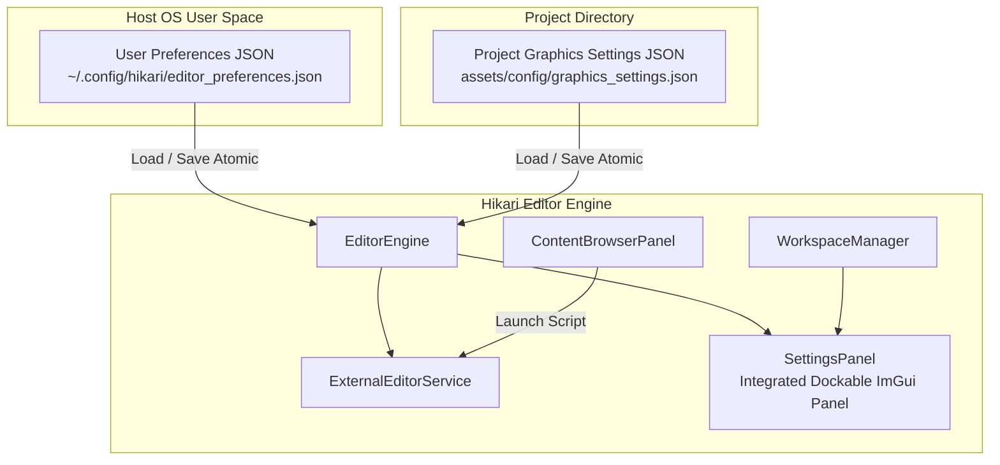
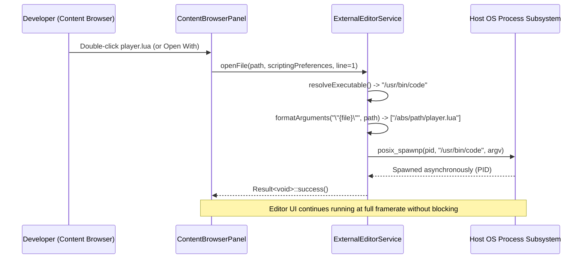

# Hikari Engine: Editor Preferences & Settings Architecture

## 1. Executive Summary & Architecture Overview

The Hikari Editor provides developer tooling, scene inspection, simulation controls, and rendering scalability. To ensure clean separation of concerns and prevent project asset pollution, configuration in Hikari is split into two strictly isolated domains:

1. **User Preferences (Cross-Project):**  
   User-specific workstation preferences that persist across all projects and engine sessions. These are stored in the host operating system's standard user configuration directory (e.g. `~/.config/hikari/editor_preferences.json` on Linux) and are never committed into project git repositories.
2. **Project Settings (Project-Specific):**  
   Configuration belonging to the currently loaded project (such as rendering scalability, lighting baseline, shadow map resolution, and post-processing profiles). These are stored in `assets/config/graphics_settings.json` within the project root and are version-controlled alongside assets and scenes.



### Key Architectural Improvements

- **Unified Dockable Panel:** Replaced the previous standalone window pattern with an integrated, dockable `SettingsPanel` (`getId() == "settings"`). It docks seamlessly into the Dear ImGui workspace and does not spawn independent OS windows.
- **Dedicated Navigation Sidebar:** A two-column layout cleanly separates **USER PREFERENCES** (General, Appearance, Workspace, Viewport, Scripting, Content Browser, Keyboard, Performance) from **PROJECT SETTINGS** (Graphics Quality, Lighting, Shadows, Post-Processing, Display & Sync, Debug Views).
- **External Script Editor Integration:** Full host IDE discovery (Visual Studio Code, Neovim, Visual Studio, system default) with argument templating, quote-safe tokenization, non-blocking asynchronous process spawning via `posix_spawnp` (preventing shell injection risks), and a test launch validator.
- **Transactional Persistence:** Atomic writing using temporary files (`.tmp`) and filesystem renames, with schema versioning and safe fallback defaults upon JSON file corruption or missing keys.

---

## 2. Configuration Domains & Filesystem Layout

### 2.1 Host OS User Preferences Path Resolution

The engine resolves user preferences dynamically via `EditorPreferencesSerializer::getDefaultPreferencesPath()`:

| Platform | Target Configuration Path | Fallback / Environment Variable |
| :--- | :--- | :--- |
| **Linux / BSD** | `$XDG_CONFIG_HOME/hikari/editor_preferences.json` | `$HOME/.config/hikari/editor_preferences.json` |
| **Windows** | `%APPDATA%\Hikari\editor_preferences.json` | `%USERPROFILE%\AppData\Roaming\Hikari\...` |
| **macOS** | `~/Library/Application Support/Hikari/editor_preferences.json` | `$HOME/Library/Application Support/...` |

### 2.2 Project Settings Path

Project-specific configuration resides within the active project tree:
```
<project_root>/assets/config/graphics_settings.json
```
This file contains the canonical `GraphicsSettings` model (Milestones 10A–10F & 11A) and is loaded on editor startup or when switching projects.

---

## 3. Data Models

### 3.1 EditorPreferences Model

The aggregated user preferences struct is declared in `editor/include/editor/editor_preferences.h`:

```cpp
namespace eng::editor {

enum class ExternalEditorType : uint8_t {
    SystemDefault = 0,
    VisualStudioCode = 1,
    Neovim = 2,
    VisualStudio = 3,
    Custom = 4,
};

struct GeneralPreferences {
    uint32_t autosaveIntervalSeconds{300};
    bool openLastProjectOnStartup{true};
    bool showWelcomeDialog{false};
    uint32_t undoHistoryLimit{100};
};

struct AppearancePreferences {
    std::string themeName{"Dark Studio"};
    float uiScaleFactor{1.0F};
    bool useMonospaceFontForScripts{true};
};

struct WorkspacePreferences {
    bool restoreLayoutOnStartup{true};
    bool confirmOnExit{true};
    bool confirmSceneRevert{true};
};

struct ViewportPreferences {
    float defaultCameraSpeed{5.0F};
    float mouseSensitivity{0.15F};
    bool invertYAxis{false};
    bool showGridByDefault{true};
    float fieldOfViewDegrees{60.0F};
};

struct ScriptingPreferences {
    ExternalEditorType editorType{ExternalEditorType::SystemDefault};
    std::string customExecutablePath{""};
    std::string argumentsTemplate{"\"{file}\""};
    bool autoSaveBeforeLaunch{true};
};

struct ContentBrowserPreferences {
    bool viewModeGrid{true};
    float thumbnailSize{72.0F};
    bool showFileExtensions{true};
    bool showHiddenFiles{false};
};

struct KeyboardPreferences {
    std::string playPauseShortcut{"Ctrl+P"};
    std::string stepShortcut{"F10"};
    std::string stopShortcut{"Ctrl+X"};
    std::string saveSceneShortcut{"Ctrl+S"};
    std::string duplicateShortcut{"Ctrl+D"};
    std::string deleteShortcut{"Delete"};
};

struct PerformancePreferences {
    uint32_t maxBackgroundFps{30};
    bool throttleWhenUnfocused{true};
    bool showTelemetryOverlay{false};
};

struct EditorPreferences {
    GeneralPreferences general{};
    AppearancePreferences appearance{};
    WorkspacePreferences workspace{};
    ViewportPreferences viewport{};
    ScriptingPreferences scripting{};
    ContentBrowserPreferences contentBrowser{};
    KeyboardPreferences keyboard{};
    PerformancePreferences performance{};

    void resetToDefaults() noexcept;
    void validateAndClamp() noexcept;
};

} // namespace eng::editor
```

### 3.2 Resilience and Schema Migration

Both serializers (`EditorPreferencesSerializer` and `GraphicsSettingsSerializer`):
- Maintain an explicit `version` header in the JSON schema (`kCurrentVersion = 1`).
- Execute file writes atomically:
  1. Write serialized JSON stream to `<target_path>.tmp`.
  2. Flush and close stream.
  3. Execute `std::filesystem::rename(<target_path>.tmp, <target_path>)`.
- On deserialization:
  - Missing fields retain their default struct values.
  - Number ranges are clamped to safe values via `validateAndClamp()`.
  - Corrupted or unparseable JSON files log a structured warning and fall back to verified default preferences without interrupting editor initialization or crashing the engine.

---

## 4. External Script Editor Service (`ExternalEditorService`)

### 4.1 System Discovery

`ExternalEditorService::detectAvailableEditors()` scans standard environment variables and binary search paths:

- **System Default:** Queries OS file associations via `xdg-open` (Linux), `open` (macOS), or `ShellExecuteW` (Windows).
- **Visual Studio Code:** Searches `PATH` for `code` (Linux/macOS) or `code.cmd`/`code.exe` (Windows).
- **Neovim:** Searches `PATH` for `nvim` or `nvim.exe`.
- **Visual Studio:** Searches `PATH` for `devenv.exe` on Windows systems.
- **Custom Executable:** Validates existence of user-supplied executable paths.

### 4.2 Safe Execution Contract (Zero Shell Concatenation)

To strictly prevent shell injection attacks, script paths are never formatted into shell strings executed via `system()` or `sh -c`. 

Instead:
1. `ExternalEditorService::formatArguments()` substitutes `{file}` with the absolute filesystem path and `{line}` with the line number.
2. The argument template is parsed using quote-aware tokenization into a vector of discrete strings `std::vector<std::string> args`.
3. On POSIX systems, `posix_spawnp` launches the target executable directly with discrete `argv` pointers and detached asynchronous execution.
4. On Windows, `CreateProcessW` executes the process safely without shell expansion.



### 4.3 Test Launch Validation

The Scripting Preferences tab provides a **Test Launch Editor** button. When clicked, it invokes `ExternalEditorService::testLaunch()`, which generates a temporary test script in the OS temp directory and verifies that the configured IDE opens without errors.

---

## 5. Unified Settings Panel UI (`SettingsPanel`)

The unified settings panel integrates all configuration into a two-column Dear ImGui interface:

### 5.1 Left Sidebar Organization

1. **Top Search Bar:** Real-time filter box that matches category names and settings keywords (e.g. "vsync", "bloom", "camera", "vscode").
2. **USER PREFERENCES Group:**
   - **General:** Autosave interval (30–1800s), open last project, welcome dialog, undo history depth.
   - **Appearance:** Editor theme selector ("Dark Studio", "Charcoal Slate", "High Contrast Dark"), UI font scale factor (0.75x–2.0x), monospace font toggle.
   - **Workspace:** Window layout restoration, exit confirmation prompts, scene revert warnings.
   - **Viewport:** Fly camera speed (0.5–50.0 m/s), mouse sensitivity (0.02–1.0), invert Y axis, show 3D grid, field of view.
   - **Scripting:** External script editor combo, live host system discovery status, custom executable path input, arguments template, auto-save toggle, and **Test Launch Editor** button.
   - **Content Browser:** Presentation mode (Grid vs List), thumbnail card size (48–128 px), file extension visibility, show hidden files.
   - **Keyboard:** Standard keybinding reference table (Simulation transport, scene save, entity operations, focus, settings).
   - **Performance:** Background FPS throttling cap (10–120 FPS), throttle when unfocused, telemetry overlay toggle.
3. **PROJECT SETTINGS Group:**
   - **Graphics Quality:** Quality presets (Low, Medium, High, Ultra, Cinematic, Custom), viewport render scale, texture quality, anisotropic filtering, anti-aliasing modes (None, FXAA, TAA, MSAA).
   - **Lighting:** Direct sun lighting toggle, ambient environment intensity slider, camera exposure.
   - **Shadows:** Directional shadow casting, shadow map resolution (512 to 4096), PCF filtering kernel, projection distance, depth bias, slope-scaled bias.
   - **Post-Processing:** HDR tone mapping operator (ACES Fitted, Filmic Reinhard, Neutral, Bypass), exposure compensation, Reinhard white point, HDR Bloom (threshold, knee, intensity, filter radius).
   - **Display & Sync:** VSync toggle, frame rate limit, dynamic resolution scaling, GPU/CPU pass profiling.
   - **Debug Views:** Diagnostic visualization modes (Lit, Wireframe, Normals, Albedo, Roughness, Metallic, Shadow Map).

### 5.2 Contextual Action Footer

The footer automatically adapts based on the active category:
- **When viewing User Preferences:**
  - `Save Preferences`: Writes current settings to the user's OS configuration file.
  - `Reset Defaults`: Restores canonical user preferences.
- **When viewing Project Settings:**
  - `Apply`: Applies graphics changes immediately to the active `SceneRenderer`.
  - `Save to Project`: Persists changes to `assets/config/graphics_settings.json`.
  - `Revert`: Discards unapplied changes and reloads the active configuration.

### 5.3 Quick-Access Triggers

The panel can be opened from multiple convenient access points:
- **Menu Bar:** `Edit -> Preferences...` (opens directly to General/Scripting).
- **Menu Bar:** `Edit -> Project Settings...` (opens directly to Graphics Quality).
- **Menu Bar:** `Window -> Settings`.
- **Main Toolbar:** Dedicated gear button `* Settings` placed on the right-hand action bar of the editor toolbar.

---

## 6. Verification and Visual Certification

### 6.1 Automated Unit Tests

Automated testing validates every layer of the architecture:

- `editor_preferences_test`:
  - `testPreferencesDefaultsAndClamping`: Validates initial defaults, boundary enforcement, and reset logic.
  - `testSerializationToStringAndBack`: Verifies full bidirectional JSON serialization and value fidelity.
  - `testFileAtomicPersistenceAndFallback`: Tests atomic writing, missing directory auto-creation, graceful fallback on missing files, and corruption recovery.
  - `testExternalEditorDetectionAndArguments`: Verifies host discovery and quote-aware argument tokenization.
  - `testExternalEditorServiceLaunchAndHook`: Validates command resolution, custom binary verification, mock hook invocation, and test launch.
- `script_editor_test`: Verifies script extension filtering, path validation, and shell injection safety.
- `editor_test`: Verifies `SettingsPanel` presence and closed-by-default behavior in `testPanelManagerAndRegistry`.

All **48/48** tests in the `editor` preset pass with 100% success rate.

### 6.2 Visual Captures

Offscreen GPU rendering verification images were produced using `tools/verify_editor_settings.cpp`:

1. `settings_user_general.png`: User Preferences — General tab with autosave and undo configuration.
2. `settings_user_scripting.png`: User Preferences — Scripting tab with host editor auto-discovery, argument template, and test launch.
3. `settings_project_quality.png`: Project Settings — Graphics Quality presets, render scale, and anti-aliasing.
4. `settings_project_postprocess.png`: Project Settings — Post-Processing tab with HDR tone mapping and bloom sliders.
