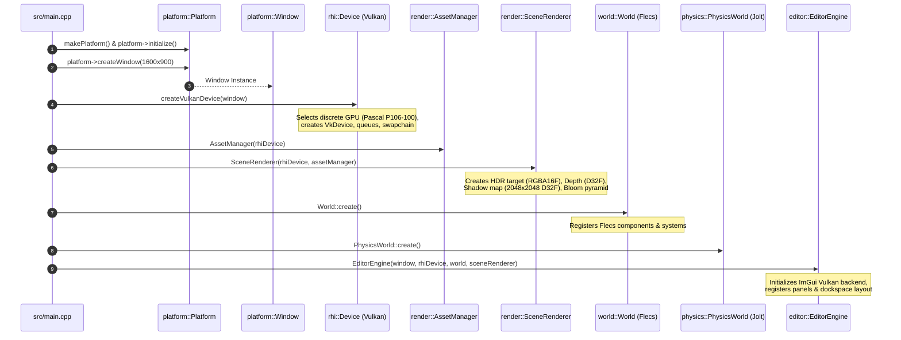
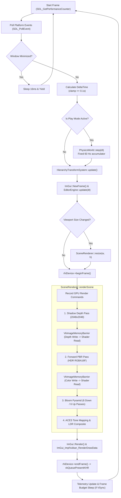
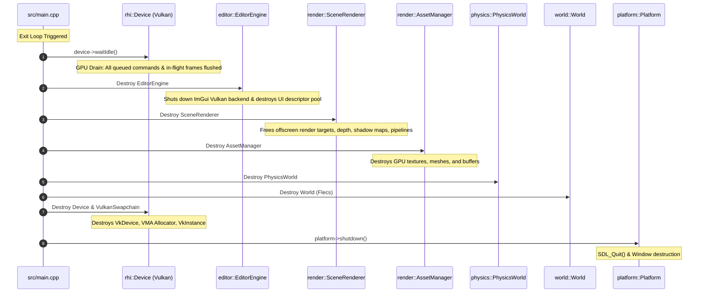

# Hikari Engine Architecture: Application Lifecycle & Execution Model

**Document ID:** `ARCH-LIFE-2026-REV1`  
**Governing Standard:** Repository Contract [`/AGENTS.md`](../../AGENTS.md)  
**Parent Document:** [`hikari_engine_architecture.md`](hikari_engine_architecture.md)  
**Related Documents:** [`hikari_rendering_architecture.md`](hikari_rendering_architecture.md), [`hikari_editor_architecture.md`](hikari_editor_architecture.md), [`hikari_resource_lifetime_and_ownership.md`](hikari_resource_lifetime_and_ownership.md)  

---

## 1. Overview & Architectural Role

The application lifecycle of Hikari Engine establishes a deterministic, strictly ordered bootstrapping sequence, a decoupled multi-rate main loop, and a leak-free reverse-order shutdown sequence. 

The entry point lives in [`src/main.cpp`](../../src/main.cpp). It coordinates the low-level platform layer, Vulkan RHI device, asset cache, Flecs ECS world, Jolt physics world, scene renderer, Dear ImGui editor, and the dual-state runtime session.

---

## 2. Bootstrapping & Initialization Sequence

The engine boot proceeds through seven strictly ordered initialization phases in [`src/main.cpp`](../../src/main.cpp). A failure at any phase aborts initialization, reports categorized diagnostics, and unwinds previously acquired resources cleanly.

### Phase-by-Phase Technical Breakdown

1. **CLI Parsing & Environment Configuration** ([`src/main.cpp:32-70`](../../src/main.cpp#L32-L70))
   - Evaluates command-line flags: `--scene <path>`, `--headless`, `--benchmark`, `--validation`, `--gpu <index>`.
   - Loads baseline user preferences from `~/.config/hikari/editor_preferences.json` if available.

2. **Platform & Window Initialization** ([`src/main.cpp:72-108`](../../src/main.cpp#L72-L108))
   - Calls `platform::makePlatform()` creating an SDL3 backend instance.
   - Initializes SDL subsystems (`SDL_INIT_VIDEO | SDL_INIT_GAMEPAD`).
   - Invokes `platform->createWindow(config)` passing `WindowFlags::Vulkan | WindowFlags::Resizable`.

3. **RHI Subsystem Initialization** ([`src/main.cpp:110-145`](../../src/main.cpp#L110-L145))
   - Calls `rhi::createVulkanDevice(window, validationEnabled)`.
   - Enumerates physical devices, prioritizes discrete GPUs (NVIDIA P106-100 over GT 1030 in dual-GPU topology), selects graphics/compute/present queue families.
   - Initializes logical `VkDevice`, VMA memory allocator, default descriptor pools, and the `VulkanSwapchain` (presentation format `VK_FORMAT_B8G8R8A8_SRGB`).

4. **Asset & Render Core Initialization** ([`src/main.cpp:148-185`](../../src/main.cpp#L148-L185))
   - Instantiates `render::AssetManager(rhiDevice)`. Uploads 1x1 default fallback textures (white, flat normal `(0.5, 0.5, 1.0)`, black, default material parameter map).
   - Instantiates `render::SceneRenderer(rhiDevice, assetManager, config)`.
   - Allocates off-screen render targets:
     - Main color HDR: `1920x1080` (or viewport size), `R16G16B16A16_SFLOAT`.
     - Main depth: `D32_SFLOAT`.
     - Directional shadow map: `2048x2048`, `D32_SFLOAT`.
     - Bloom pyramid: 6 downsample/upsample mip levels (`R16G16B16A16_SFLOAT`).
   - Compiles and binds SPIR-V pipelines for shadow pass, forward PBR pass, bloom down/up passes, and tone mapping composite pass.

5. **World & Physics Initialization** ([`src/main.cpp:188-215`](../../src/main.cpp#L188-L215))
   - Calls `world::World::create()`, wrapping a `flecs::world`.
   - Registers core component types: `NameComponent`, `TransformComponent`, `WorldTransformComponent`, `HierarchyComponent`, `MeshComponent`, `MaterialComponent`, `LightComponent`, `CameraComponent`.
   - Instantiates `physics::PhysicsWorld::create()`, establishing Jolt physics memory arenas, broadphase layers (NonMoving, Moving), and gravity vectors.

6. **Editor Subsystem Initialization** ([`src/main.cpp:218-260`](../../src/main.cpp#L218-L260))
   - Instantiates `editor::EditorEngine(window, rhiDevice, world, sceneRenderer)`.
   - Sets up ImGui context, loads font atlases, configures docking branches (`ImGuiConfigFlags_DockingEnable | ImGuiConfigFlags_ViewportsEnable`).
   - Initializes `ImGui_ImplSDL3_InitForVulkan` and `ImGui_ImplVulkan_Init`.
   - Registers core panels: `ViewportPanel`, `HierarchyPanel`, `InspectorPanel`, `ContentBrowserPanel`, `MetricsPanel`, `SettingsPanel`.

7. **Scene Ingestion & Bootstrap Verification** ([`src/main.cpp:262-290`](../../src/main.cpp#L262-L290))
   - If `--scene` is supplied, deserializes via `world::SceneSerializer::deserializeJson()`.
   - Otherwise, loads persistent default benchmark scene (`assets/scenes/sponza_benchmark.hikari` or creates a default camera/light entity pair).

---

## 3. Main Frame Execution Cycle

The main frame loop runs inside `src/main.cpp:295-410`. It executes on the main thread and enforces a single-threaded CPU command submission model to the Vulkan graphics queue.

### Detailed Execution Stages

1. **Platform Event Dispatch:**
   - Polls SDL events via `platform->pollEvents()`.
   - Passes input directly to `editor::EditorEngine::handleEvent()`. If ImGui captures keyboard (`io.WantCaptureKeyboard`) or mouse (`io.WantCaptureMouse`), game input propagation is withheld.
   - Handles window events (`SDL_EVENT_WINDOW_RESIZED`, `SDL_EVENT_WINDOW_CLOSE_REQUESTED`, `SDL_EVENT_WINDOW_MINIMIZED`).

2. **Simulation & Physics Ticking:**
   - Evaluates simulation state via `framework::RuntimeSession::state()`.
   - If `State::Playing`: updates fixed timestep accumulator ($60\text{ Hz} = 16.666\text{ ms}$). Executes `physicsWorld->step(fixedDt)`. Synchronizes resulting rigid body velocities and positions into `PhysicsTransformComponent`.
   - Updates `HierarchyTransformSystem::update(world)` to ensure root-to-leaf world transform propagation across Flecs entities.

3. **Editor & UI Layout Update:**
   - Starts ImGui frame (`ImGui_ImplVulkan_NewFrame()`, `ImGui_ImplSDL3_NewFrame()`, `ImGui::NewFrame()`).
   - Updates `EditorEngine::draw()` which draws main menu bar, status bar, and all active dockable panels.
   - `ViewportPanel` queries its available screen rectangle. If dimensions differ from offscreen render target, it flags `SceneRenderer::resize(newWidth, newHeight)`.

4. **Off-screen Scene Rendering:**
   - Acquires Vulkan command list: `auto* cmd = rhiDevice->beginFrame()`.
   - Extracts active camera parameters (from `ViewportPanel` editor camera or ECS `CameraComponent`).
   - Invokes `sceneRenderer->renderScene(cmd, world, camera, lightSetup)`.
   - Generates offscreen LDR target containing final tonemapped scene.

5. **Viewport Texture Binding:**
   - The LDR target `VkImageView` is bound into an ImGui Vulkan descriptor set using `ImGui_ImplVulkan_AddTexture()`.
   - Rendered directly inside `ViewportPanel` via `ImGui::Image(descriptorSet, viewportSize)`.

6. **ImGui Overlay Recording & Presentation:**
   - Commences swapchain render pass on the backbuffer (`vkCmdBeginRenderPass`).
   - Dispatches ImGui draw data via `ImGui_ImplVulkan_RenderDrawData(ImGui::GetDrawData(), cmd)`.
   - Concludes command buffer recording: `cmd->end()`.
   - Submits to Vulkan graphics queue with fence: `vkQueueSubmit()`.
   - Presents swapchain image: `vkQueuePresentKHR()`.

---

## 4. Deterministic Shutdown Sequence

Shutdown occurs when `window->shouldClose()` returns true or an engine termination signal is intercepted. The sequence strictly executes in reverse order of construction to prevent dangling references, GPU validation layer crashes, or memory leaks.

### Shutdown Invariants & Guarantees

- **Invariant 1 (GPU Drain First):** `rhiDevice->waitIdle()` must complete before any GPU resource (pipeline, image view, buffer, descriptor set) is released.
- **Invariant 2 (ImGui Teardown Before RHI):** `ImGui_ImplVulkan_Shutdown()` and `ImGui_ImplSDL3_Shutdown()` must destroy all ImGui descriptor sets before the `VkDescriptorPool` and `VkDevice` are destroyed.
- **Invariant 3 (Asset Teardown Before Device):** All `GpuMesh` and `GpuTexture` buffers and samplers held by `AssetManager` must be destroyed prior to `rhiDevice` destruction.
- **Invariant 4 (ECS Teardown After Systems):** Flecs ECS `world` destruction releases all entity tables and components. No system or renderer may hold references to Flecs entities during or after world destruction.
