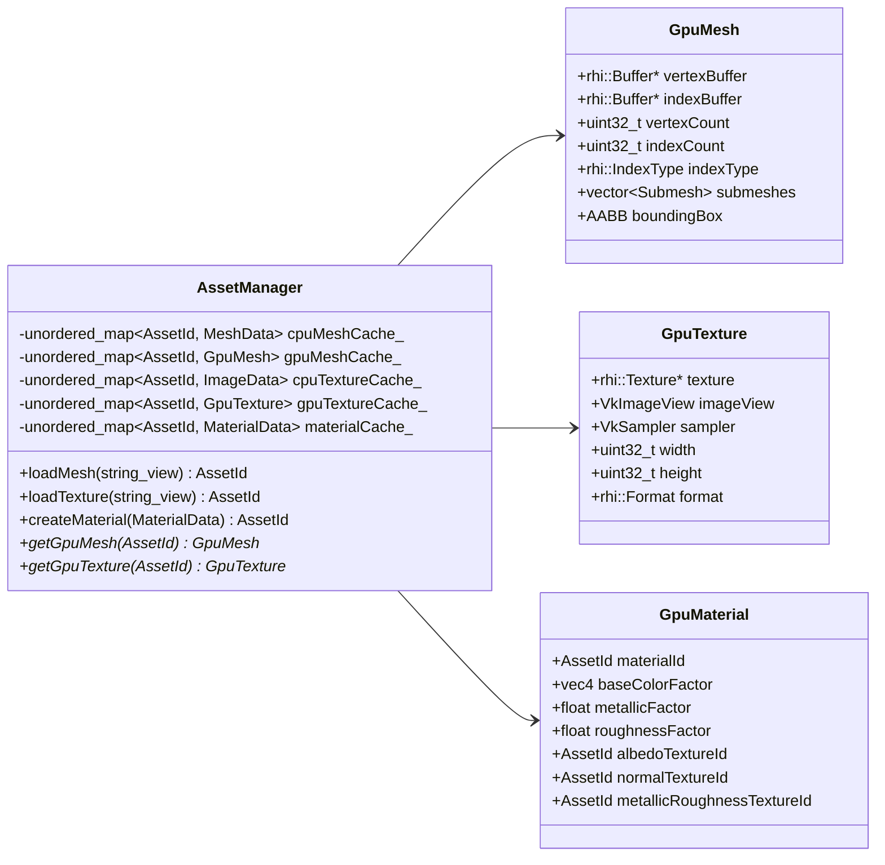
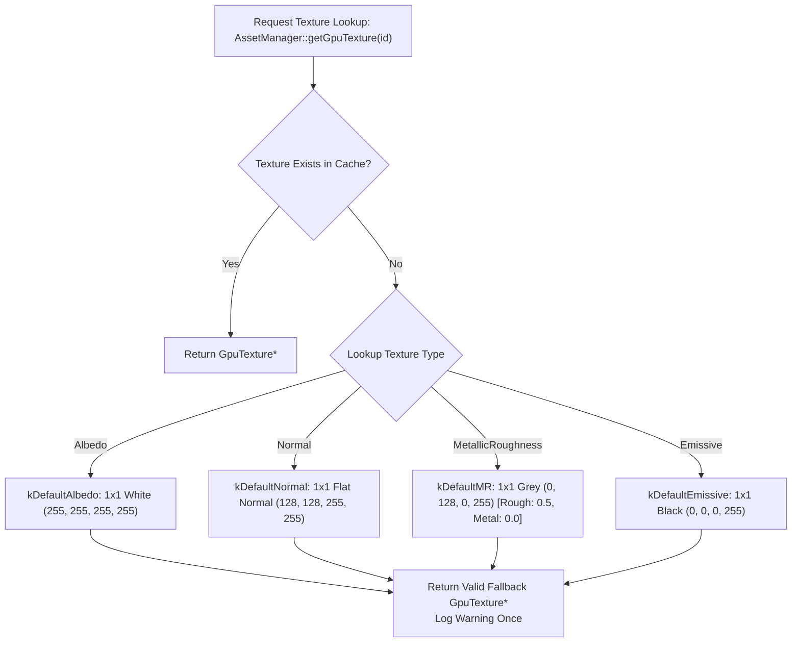

# Hikari Engine Architecture: Asset Pipeline & Resource Management

**Document ID:** `ARCH-ASSET-2026-REV1`  
**Governing Standard:** Repository Contract [`/AGENTS.md`](../../AGENTS.md)  
**Parent Document:** [`hikari_engine_architecture.md`](hikari_engine_architecture.md)  
**Related Documents:** [`hikari_rendering_architecture.md`](hikari_rendering_architecture.md), [`hikari_resource_lifetime_and_ownership.md`](hikari_resource_lifetime_and_ownership.md)  

---

## 1. Overview & Architectural Role

Hikari's asset pipeline manages the ingestion, compilation, runtime caching, and GPU staging of external 3D models, textures, materials, and persistent scene descriptors.

Centralized in [`render::AssetManager`](../../engine/render/include/render/asset_manager.h), the system guarantees:
- Stable, deterministic identification of all assets using 64-bit FNV-1a hashes (`AssetId`).
- Complete separation between host-accessible CPU memory structures (`MeshData`, `ImageData`, `MaterialData`) and device-local GPU resources (`GpuMesh`, `GpuTexture`, `GpuMaterial`).
- Deterministic fallback assets ensuring that missing or asynchronous resources never trigger null dereferences or Vulkan device crashes.

---

## 2. Asset Identification & Address Model

Every asset in Hikari is addressed via a 64-bit unsigned handle:
```cpp
using AssetId = uint64_t;
```

`AssetId` values are computed using the **FNV-1a 64-bit hash algorithm** over normalized virtual resource paths.
- File path example: `"assets/textures/sponza_fabric_diff.png"` $\to$ `0x9e4b7c12f0a38d15`
- Sub-resource example: `"assets/models/Sponza.gltf#mesh_12"` $\to$ `0x3a2c8f01b4e57920`

### Properties of `AssetId`:
1. **Deterministic:** Two instances compiling the same virtual path generate identical IDs across runs, platforms, and machines.
2. **Zero Run-Time Allocation:** Hash identifiers are passed by value (8 bytes) across Flecs ECS components (`MeshComponent`, `MaterialComponent`), completely eliminating string allocations in the hot path.
3. **Collision Resistance:** $2^{64}$ address space ensures zero practical probability of collision across game and engine assets.

---

## 3. End-to-End Asset Ingestion & GPU Upload Flow

When an external asset (such as a glTF model or PNG texture) is requested, it transitions through a three-stage pipeline: CPU decoding, memory staging, and GPU device-local allocation.

```mermaid
sequenceDiagram
    autonumber
    participant Client as Importer / SceneLoader
    participant AM as render::AssetManager
    participant Disk as Filesystem (glTF / PNG)
    participant Staging as Host Staging Buffer (RAM)
    participant GPU as Device Local VRAM (P106-100)
    participant RHI as rhi::VulkanDevice

    Client->>AM: loadMesh("assets/models/Sponza.gltf")
    AM->>AM: Compute AssetId = fnv1a64(path)
    alt Asset Already Cached?
        AM-->>Client: Return cached AssetId
    else Asset Not Cached
        AM->>Disk: Read file via tinygltf / stb_image
        Disk-->>AM: Raw vertex/index arrays
        AM->>AM: Parse submeshes & compute AABBs
        
        Note over AM,Staging: GPU Memory Staging Phase
        AM->>RHI: createBuffer(staging, HOST_VISIBLE | TRANSFER_SRC)
        AM->>Staging: memcpy(vertexData + indexData)
        
        AM->>RHI: createBuffer(gpuBuffer, DEVICE_LOCAL | VERTEX_BUFFER | TRANSFER_DST)
        AM->>RHI: beginTransferCommandBuffer()
        AM->>RHI: vkCmdCopyBuffer(staging -> gpuBuffer)
        AM->>RHI: submitTransfer() & waitFence()
        
        AM->>RHI: destroyBuffer(staging)
        AM->>GPU: Record GpuMesh handle in AssetManager cache
        AM-->>Client: Return valid AssetId
    end
```



### Technical Upload Details:
1. **Host-Visible Staging Allocation:**
   - Dedicated transient staging buffers are allocated with `VMA_MEMORY_USAGE_CPU_ONLY` and `VK_BUFFER_USAGE_TRANSFER_SRC_BIT`.
   - Data is copied directly from `tinygltf` buffers via `memcpy`.
2. **Device-Local Target Allocation:**
   - High-performance device-local buffers are allocated with `VMA_MEMORY_USAGE_GPU_ONLY` and combined usage flags: `VK_BUFFER_USAGE_VERTEX_BUFFER_BIT | VK_BUFFER_USAGE_INDEX_BUFFER_BIT | VK_BUFFER_USAGE_TRANSFER_DST_BIT`.
3. **Queue Transfer & Synchronization:**
   - The copy is queued via `vkCmdCopyBuffer`.
   - A buffer memory barrier enforces that `VK_ACCESS_TRANSFER_WRITE_BIT` completes before `VK_ACCESS_VERTEX_ATTRIBUTE_READ_BIT` or `VK_ACCESS_INDEX_READ_BIT` occurs in the graphics pipeline.
4. **Staging Reclamation:**
   - Staging buffers are destroyed immediately after fence synchronization, preventing memory leaks during scene import.

---

## 4. In-Memory Asset Cache Architecture

`AssetManager` maintains concurrent lookup tables mapping `AssetId` to CPU data structures and GPU resource records.



---

## 5. Built-in Fallback Resource Registry

To fulfill `/AGENTS.md` Rule 9 (Error Handling: no silent failures, no crashes on missing resources), `AssetManager` pre-allocates default fallback textures and materials during engine boot:



### Guaranteed Engine Invariants:
1. **Never Null on Texture Fetch:** `AssetManager::getGpuTexture(id)` returns either the valid loaded texture or a valid type-specific fallback. The renderer never encounters a null `VkImageView` or `VkSampler`.
2. **Missing Geometry Visual Marker:** If a referenced `AssetId` for geometry is not found, the renderer renders a fallback unit cube with a high-visibility magenta wireframe.
