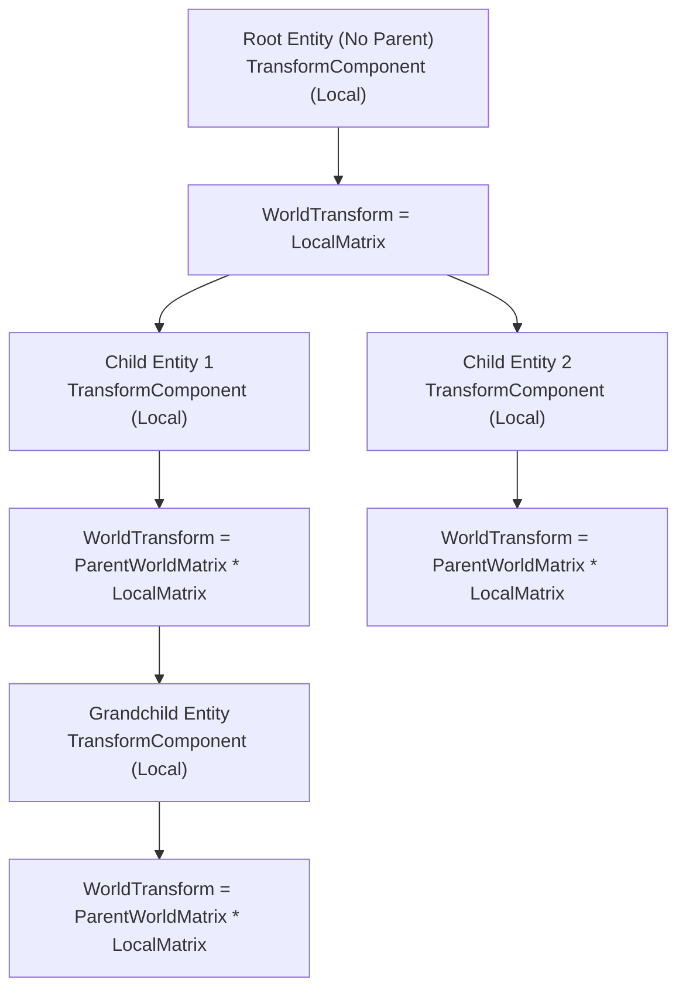
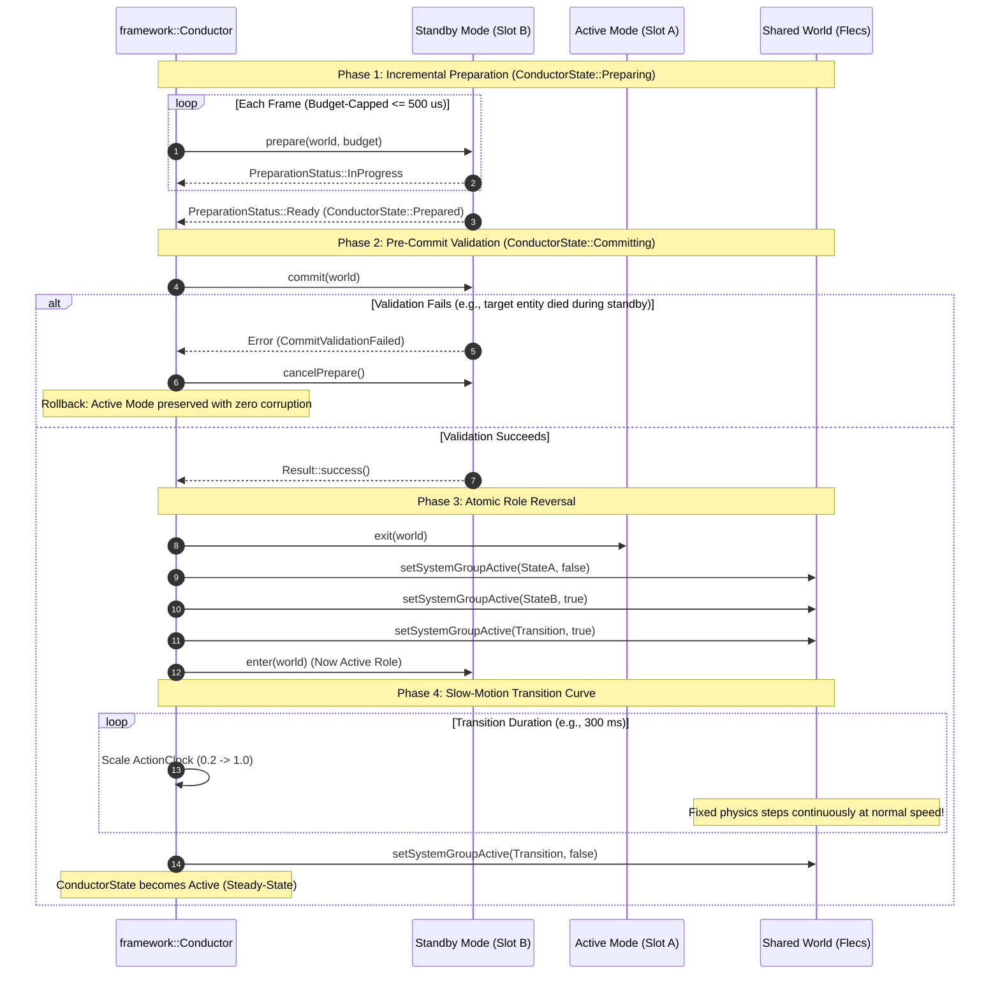
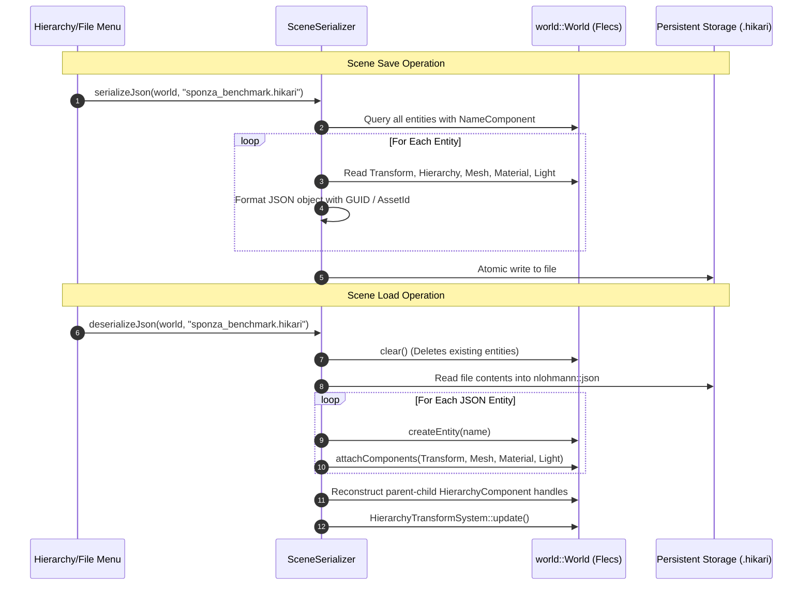

# Hikari Engine Architecture: ECS & World State Architecture

**Document ID:** `ARCH-ECS-2026-REV1`  
**Governing Standard:** Repository Contract [`/AGENTS.md`](../../AGENTS.md)  
**Parent Document:** [`hikari_engine_architecture.md`](hikari_engine_architecture.md)  
**Related Documents:** [`hikari_rendering_architecture.md`](hikari_rendering_architecture.md), [`hikari_application_lifecycle.md`](hikari_application_lifecycle.md), [`hikari_resource_lifetime_and_ownership.md`](hikari_resource_lifetime_and_ownership.md)  

---

## 1. Overview & Architectural Role

The ECS and World architecture forms the central data backbone of Hikari Engine. Implemented in [`engine/world/`](../../engine/world/), it encapsulates the third-party **Flecs ECS** library within the clean engine namespace `eng::world::World`. 

In accordance with `/AGENTS.md` Rule 8 (Conductor and Modes) and Rule 4 (C++ Style):
- Components are strictly plain data (POD structs), containing no behaviors, virtual functions, or owning pointers.
- Systems contain all logic and query narrow, cached component archetypes.
- Entities are referenced externally via generational `EntityHandle` primitives to prevent stale pointer dereferences.
- World isolation between editor editing and live simulation is achieved via snapshot/restoration in [`framework::RuntimeSession`](../../engine/framework/include/framework/runtime_session.h).

---

## 2. Component Taxonomy & Data Layout

Components represent pure data slices aligned for cache locality and cache-line streaming within Flecs archetype tables.

```mermaid
classDiagram
    direction TB
    class EntityHandle {
        +uint64_t id
        +uint32_t generation
        +bool isValid()
    }

    class NameComponent {
        +string name
    }

    class TransformComponent {
        +vec3 position
        +quat rotation
        +vec3 scale
        +mat4 getLocalMatrix()
    }

    class WorldTransformComponent {
        +mat4 worldMatrix
        +vec3 worldPosition
        +quat worldRotation
        +vec3 worldScale
        +bool isDirty
    }

    class HierarchyComponent {
        +EntityHandle parent
        +EntityHandle firstChild
        +EntityHandle nextSibling
        +EntityHandle prevSibling
        +uint32_t childCount
    }

    class MeshComponent {
        +AssetId meshAssetId
        +uint32_t submeshIndex
        +bool castShadows
        +bool receiveShadows
        +AABB localBounds
    }

    class MaterialComponent {
        +vec4 baseColorFactor
        +float metallicFactor
        +float roughnessFactor
        +vec3 emissiveFactor
        +AssetId albedoTexture
        +AssetId normalTexture
        +AssetId metallicRoughnessTexture
        +AssetId emissiveTexture
    }

    class LightComponent {
        +LightType type
        +vec3 color
        +float intensity
        +float range
        +float spotInnerAngle
        +float spotOuterAngle
        +bool castShadows
    }

    class CameraComponent {
        +ProjectionType type
        +float fovY
        +float nearPlane
        +float farPlane
        +float aspectRatio
        +bool isPrimary
    }

    class PhysicsBodyComponent {
        +BodyType bodyType
        +ShapeType shapeType
        +vec3 boxExtents
        +float sphereRadius
        +float mass
        +float friction
        +float restitution
        +uint32_t joltBodyId
    }

    EntityHandle --> NameComponent
    EntityHandle --> TransformComponent
    EntityHandle --> WorldTransformComponent
    EntityHandle --> HierarchyComponent
    EntityHandle --> MeshComponent
    EntityHandle --> MaterialComponent
    EntityHandle --> LightComponent
    EntityHandle --> CameraComponent
    EntityHandle --> PhysicsBodyComponent
```



### Component Breakdown & Memory Characteristics

| Component | Header Location | Memory Layout | Purpose |
|---|---|---|---|
| `NameComponent` | [`world/components.h`](../../engine/world/include/world/components.h) | Small heap (`std::string`) | Entity naming, debugging, editor display |
| `TransformComponent` | [`world/components.h`](../../engine/world/include/world/components.h) | POD (40 bytes): `vec3, quat, vec3` | Local transformation relative to parent |
| `WorldTransformComponent` | [`world/components.h`](../../engine/world/include/world/components.h) | POD (112 bytes): `mat4, vec3, quat, vec3, bool` | Final computed world-space transformation |
| `HierarchyComponent` | [`world/components.h`](../../engine/world/include/world/components.h) | POD (40 bytes): 4x `EntityHandle`, count | Intrusive double-linked tree hierarchy |
| `MeshComponent` | [`world/components.h`](../../engine/world/include/world/components.h) | POD (48 bytes): `AssetId, uint32, bools, AABB` | Link to GPU mesh resource and submesh index |
| `MaterialComponent` | [`world/components.h`](../../engine/world/include/world/components.h) | POD (80 bytes): factors + `AssetId` handles | Surface PBR material properties |
| `LightComponent` | [`world/components.h`](../../engine/world/include/world/components.h) | POD (48 bytes): type, colors, angles, flags | Directional, point, or spot light source |
| `CameraComponent` | [`world/components.h`](../../engine/world/include/world/components.h) | POD (32 bytes): FOV, clipping, flags | Scene capture and viewport projection |
| `PhysicsBodyComponent` | [`physics/physics_world.h`](../../engine/physics/include/physics/physics_world.h) | POD (44 bytes): body type, mass, friction, Jolt ID | Physics rigid body simulation state |

---

## 3. Entity Hierarchy & Transform Propagation

Hikari separates local transforms from world transforms to avoid recalculating matrices for static objects and to allow efficient depth-first tree propagation.

### Mathematical Invariant:
$$\mathbf{M}_{\text{world}}(\text{child}) = \mathbf{M}_{\text{world}}(\text{parent}) \times \mathbf{M}_{\text{local}}(\text{child})$$



### Hierarchy Transform Update Algorithm:
1. `HierarchyTransformSystem::update(world)` queries all entities with `TransformComponent` and `HierarchyComponent` where `parent == NullEntity`.
2. For each root entity:
   - Computes local transform matrix $\mathbf{M}_{\text{local}} = \mathbf{T} \times \mathbf{R} \times \mathbf{S}$.
   - Stores $\mathbf{M}_{\text{local}}$ into `WorldTransformComponent::worldMatrix`.
   - Iterates through child entities via `firstChild` and `nextSibling` linked list.
3. Recursively updates children passing the parent's `worldMatrix`:
   - Computes $\mathbf{M}_{\text{local}}(\text{child})$.
   - Computes $\mathbf{M}_{\text{world}}(\text{child}) = \mathbf{M}_{\text{world}}(\text{parent}) \times \mathbf{M}_{\text{local}}(\text{child})$.
   - Decomposes matrix to update world position, rotation, and scale for spatial queries.
4. If an entity has a `PhysicsTransformComponent` (dynamic rigid body), the physics transform overwrites the local transform before hierarchy propagation.

---

## 4. Two-State Conductor over Single Shared World Architecture

### 4.1 The Single Shared World Contract

In accordance with `/AGENTS.md` Rule 8, Hikari Engine's defining operational mechanism is the **Two-State Conductor operating over a single shared World**.

```mermaid
graph TB
    subgraph SingleSharedWorld [Single Shared Flecs World (eng::world::World)]
        Entities["Shared Entity Population (Hero, Enemies, Geometry, Lights)"]
        ContinuousGroup["SystemGroup::Continuous (Physics, Hierarchy Transforms, Audio)"]
        StateAGroup["SystemGroup::StateA (Active Mode Systems)"]
        StateBGroup["SystemGroup::StateB (Standby Mode Systems)"]
        TransitionGroup["SystemGroup::Transition (Slow-Motion Transition Systems)"]
    end

    subgraph ConductorRuntime [Two-State Conductor (eng::framework::Conductor)]
        SlotA["Slot A (Active Role)"]
        SlotB["Slot B (Standby Role)"]
        CtxA["StateContext A (Camera, Targeting, UI, Input)"]
        CtxB["StateContext B (Camera, Targeting, UI, Input, Cache)"]
    end

    ConductorRuntime -->|Gates System Groups| ContinuousGroup
    ConductorRuntime -->|Enables / Disables| StateAGroup
    ConductorRuntime -->|Enables / Disables| StateBGroup
    ConductorRuntime -->|Enables During Curve| TransitionGroup
    SlotA -.->|Direct Pointer / Reference| Entities
    SlotB -.->|Direct Pointer / Reference| Entities
    SlotA --- CtxA
    SlotB --- CtxB
```

#### Core Invariants:
1. **Single World Identity:** Exactly one authoritative Flecs ECS world (`world::World`) exists for gameplay states A and B. Both states operate on the same world address.
2. **Zero World Duplication:** Transitioning between State A and State B never creates an ECS world, clones entities, serializes state to disk, or reloads the scene.
3. **Continuous Simulation Persistence:** Systems in `SystemGroup::Continuous` (rigid-body physics integration, hierarchy transform propagation, audio streaming) remain continuously active across all transitions without interruption or reset.
4. **StateContext Separation:** Mode-specific state context ([`framework::StateContext`](../../engine/framework/include/framework/state_context.h)) is stored separately from world entity components:
   - Camera parameters (`activeCamera`, FOV, clipping planes)
   - Target query candidates (`primaryTarget`, `candidateTargets`)
   - UI presentation state (`documentPath`, active HUD masks)
   - Input context tags and action filtering masks
   - Speculative preparation caches (`preparedAssetIds`, `preparedEntities`)

---

### 4.2 SystemGroup Scheduling & Lifecycle Gating

The Conductor schedules work across 4 distinct system groups without touching entity data:

| System Group | Phase Tag | Active Condition | Typical Workloads |
|---|---|---|---|
| `SystemGroup::Continuous` | `Continuous = 0` | **Always Active** (100% of frames) | Jolt physics stepping, transform propagation, audio |
| `SystemGroup::StateA` | `StateA = 1` | Active when `activeSlot == SlotA` | State A gameplay rules, combat actions, camera controllers |
| `SystemGroup::StateB` | `StateB = 2` | Active when `activeSlot == SlotB` | State B gameplay rules, exploration actions, skill selectors |
| `SystemGroup::Transition` | `Transition = 3` | Active **only** during slow motion | Camera blending, transition VFX, time dilation controllers |

---

### 4.3 Atomic State Transition Lifecycle

Transitions proceed through an explicit 5-phase validation lifecycle:



---

### 4.4 Disambiguation: Editor Play-in-Editor (PIE) Session

To prevent confusing gameplay mode transitions with level authoring workflows:

- **The Gameplay Architecture:** The Two-State Conductor operating over the Single Shared World is the core runtime architecture of Hikari Engine. It is used in all standalone builds and during gameplay execution.
- **The Editor Workflow ([`framework::RuntimeSession`](../../engine/framework/include/framework/runtime_session.h)):** `RuntimeSession` is an **Editor-only authoring tool**. When an artist or designer clicks "Play" in the Editor toolbar to test a level, `RuntimeSession` (with `isolateWorld = true`) stages the authoring `editWorld` in memory and executes a temporary preview instance, guaranteeing that when they click "Stop", the level authoring state returns to its exact pre-test state without lingering physics displacements.
- **Independence:** The gameplay Conductor's State A/B transitions are 100% independent of `RuntimeSession` and never duplicate the shared world. When `RuntimeSessionConfig::isolateWorld == false`, `RuntimeSession` also executes directly on the shared world.

---

## 5. Scene Serialization Architecture

Hikari employs a human-readable JSON serialization format (`.hikari`) managed by [`world::SceneSerializer`](../../engine/world/include/world/scene_serializer.h).

### Serialization Lifecycle:


### JSON Schema Structure:
```json
{
  "scene": "Sponza Benchmark",
  "version": 1,
  "entities": [
    {
      "id": 1024,
      "name": "Directional Light",
      "transform": {
        "position": [0.0, 15.0, 0.0],
        "rotation": [-0.5, 0.5, 0.5, 0.5],
        "scale": [1.0, 1.0, 1.0]
      },
      "light": {
        "type": "Directional",
        "color": [1.0, 0.95, 0.8],
        "intensity": 5.0,
        "castShadows": true
      }
    },
    {
      "id": 1025,
      "name": "Sponza_Arch_01",
      "mesh": {
        "assetId": "0x8f3c7a2b109e4d50",
        "submeshIndex": 3,
        "castShadows": true
      },
      "material": {
        "baseColor": [1.0, 1.0, 1.0, 1.0],
        "roughness": 0.8,
        "metallic": 0.0,
        "albedoTexture": "0x5a1b2c3d4e5f6071"
      }
    }
  ]
}
```
