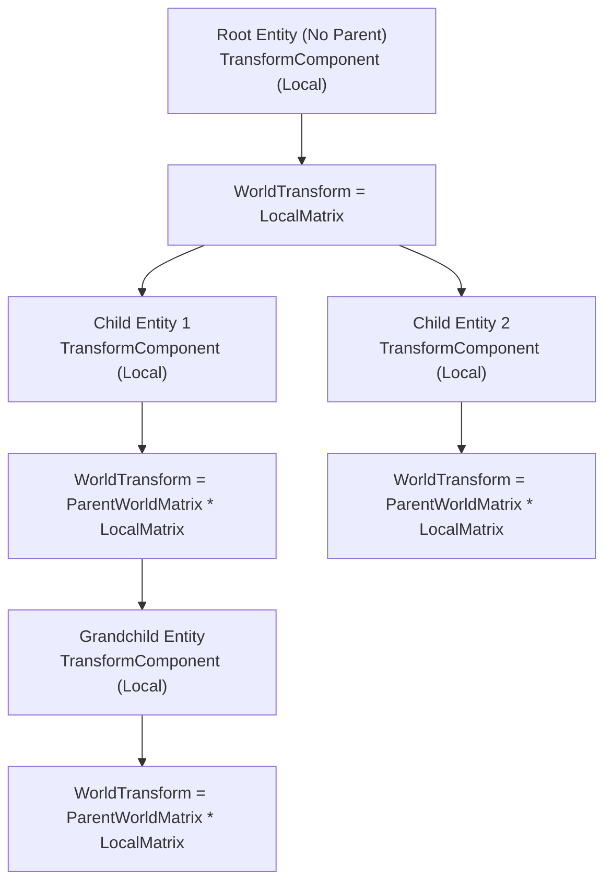
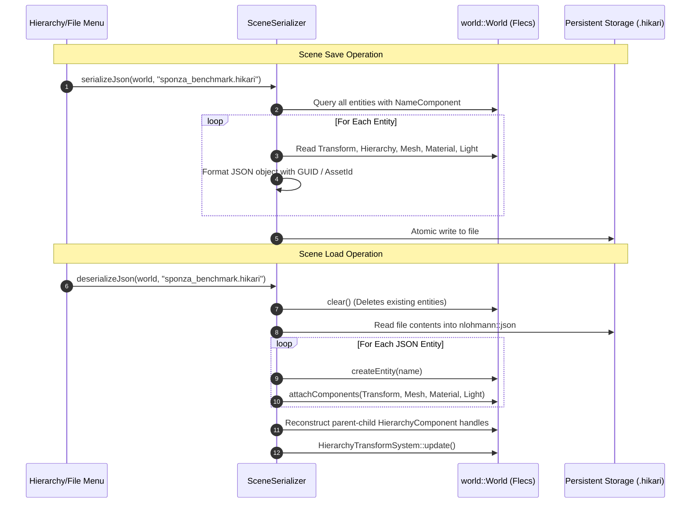

# Hikari Engine Architecture: ECS & World State Architecture

**Document ID:** `ARCH-ECS-2026-REV1`  
**Governing Standard:** Repository Contract [`/AGENTS.md`](../../AGENTS.md)  
**Parent Document:** [`hikari_engine_architecture.md`](hikari_engine_architecture.md)  
**Related Documents:** [`hikari_rendering_architecture.md`](hikari_rendering_architecture.md), [`hikari_application_lifecycle.md`](hikari_application_lifecycle.md), [`hikari_resource_lifetime_and_ownership.md`](hikari_resource_lifetime_and_ownership.md)  

---

## 1. Overview & Architectural Role

The ECS and World architecture forms the central data backbone of Hikari Engine. Implemented in [`engine/world/`](../../engine/world/), it encapsulates the third-party **Flecs ECS** library within the clean engine namespace `eng::world::World`. 

In accordance with `/AGENTS.md` Rule 8 (Conductor and Modes) and Rule 4 (C++ Style):
- Components are strictly plain data (POD structs), containing no behaviors, virtual functions, or owning pointers.
- Systems contain all logic and query narrow, cached component archetypes.
- Entities are referenced externally via generational `EntityHandle` primitives to prevent stale pointer dereferences.
- World isolation between editor editing and live simulation is achieved via snapshot/restoration in [`framework::RuntimeSession`](../../engine/framework/include/framework/runtime_session.h).

---

## 2. Component Taxonomy & Data Layout

Components represent pure data slices aligned for cache locality and cache-line streaming within Flecs archetype tables.


### Component Breakdown & Memory Characteristics

| Component | Header Location | Memory Layout | Purpose |
|---|---|---|---|
| `NameComponent` | [`world/components.h`](../../engine/world/include/world/components.h) | Small heap (`std::string`) | Entity naming, debugging, editor display |
| `TransformComponent` | [`world/components.h`](../../engine/world/include/world/components.h) | POD (40 bytes): `vec3, quat, vec3` | Local transformation relative to parent |
| `WorldTransformComponent` | [`world/components.h`](../../engine/world/include/world/components.h) | POD (112 bytes): `mat4, vec3, quat, vec3, bool` | Final computed world-space transformation |
| `HierarchyComponent` | [`world/components.h`](../../engine/world/include/world/components.h) | POD (40 bytes): 4x `EntityHandle`, count | Intrusive double-linked tree hierarchy |
| `MeshComponent` | [`world/components.h`](../../engine/world/include/world/components.h) | POD (48 bytes): `AssetId, uint32, bools, AABB` | Link to GPU mesh resource and submesh index |
| `MaterialComponent` | [`world/components.h`](../../engine/world/include/world/components.h) | POD (80 bytes): factors + `AssetId` handles | Surface PBR material properties |
| `LightComponent` | [`world/components.h`](../../engine/world/include/world/components.h) | POD (48 bytes): type, colors, angles, flags | Directional, point, or spot light source |
| `CameraComponent` | [`world/components.h`](../../engine/world/include/world/components.h) | POD (32 bytes): FOV, clipping, flags | Scene capture and viewport projection |
| `PhysicsBodyComponent` | [`physics/physics_world.h`](../../engine/physics/include/physics/physics_world.h) | POD (44 bytes): body type, mass, friction, Jolt ID | Physics rigid body simulation state |

---

## 3. Entity Hierarchy & Transform Propagation

Hikari separates local transforms from world transforms to avoid recalculating matrices for static objects and to allow efficient depth-first tree propagation.

### Mathematical Invariant:
$$\mathbf{M}_{\text{world}}(\text{child}) = \mathbf{M}_{\text{world}}(\text{parent}) \times \mathbf{M}_{\text{local}}(\text{child})$$



### Hierarchy Transform Update Algorithm:
1. `HierarchyTransformSystem::update(world)` queries all entities with `TransformComponent` and `HierarchyComponent` where `parent == NullEntity`.
2. For each root entity:
   - Computes local transform matrix $\mathbf{M}_{\text{local}} = \mathbf{T} \times \mathbf{R} \times \mathbf{S}$.
   - Stores $\mathbf{M}_{\text{local}}$ into `WorldTransformComponent::worldMatrix`.
   - Iterates through child entities via `firstChild` and `nextSibling` linked list.
3. Recursively updates children passing the parent's `worldMatrix`:
   - Computes $\mathbf{M}_{\text{local}}(\text{child})$.
   - Computes $\mathbf{M}_{\text{world}}(\text{child}) = \mathbf{M}_{\text{world}}(\text{parent}) \times \mathbf{M}_{\text{local}}(\text{child})$.
   - Decomposes matrix to update world position, rotation, and scale for spatial queries.
4. If an entity has a `PhysicsTransformComponent` (dynamic rigid body), the physics transform overwrites the local transform before hierarchy propagation.

---

## 4. RuntimeSession: Play/Edit Mode Isolation

To guarantee that game execution during Play mode does not permanently alter, corrupt, or leave lingering physics drifts on the scene authoring state, [`framework::RuntimeSession`](../../engine/framework/include/framework/runtime_session.h) implements a complete world isolation and rollback protocol.

```mermaid
stateDiagram-v2
    [*] --> EditMode: Initial Startup

    state EditMode {
        [*] --> SceneAuthoring: Load Scene / Edit Transforms
        SceneAuthoring --> SelectionAndGizmos: Modify Entities
    }

    EditMode --> PlayMode: User Clicks "Play"
    note on link
        1. Deep clone editWorld_ -> runtimeWorld_
        2. Initialize Jolt physics bodies in runtimeWorld_
        3. Switch active simulation pointer to runtimeWorld_
        4. Start Action & Physics Clocks
    end note

    state PlayMode {
        [*] --> SimulationRunning: 60Hz Physics & Game Systems
        SimulationRunning --> Paused: User Clicks "Pause"
        Paused --> SimulationRunning: User Clicks "Resume"
        SimulationRunning --> SimulationStep: User Clicks "Step Frame"
        SimulationStep --> Paused
    }

    PlayMode --> EditMode: User Clicks "Stop"
    note on link
        1. Terminate all physics simulations
        2. Discard and destroy runtimeWorld_
        3. Restore active world pointer to pristine editWorld_
        4. Rebind Editor selection and UI inspectors
    end note
```

### Technical Rollback Mechanics
1. **On Entering Play Mode (`RuntimeSession::play()`):**
   - Serializes or clones the active `editWorld_` into an isolated `runtimeWorld_`.
   - Traverses all entities in `runtimeWorld_` containing `PhysicsBodyComponent` and creates corresponding Jolt rigid bodies (`JPH::BodyID`) in `physics::PhysicsWorld`.
   - Sets the Conductor and Editor active target to `runtimeWorld_`.
2. **During Play Mode:**
   - ECS systems, scripts, and physics execute exclusively against `runtimeWorld_`.
   - Any spawned projectiles, destroyed entities, or mutated transforms affect only `runtimeWorld_`.
3. **On Exiting Play Mode (`RuntimeSession::stop()`):**
   - Destroys all Jolt physics bodies associated with `runtimeWorld_`.
   - Destroys `runtimeWorld_` completely, freeing its Flecs tables.
   - Points the Conductor and Editor back to the untouched `editWorld_`.
   - Restores exact pre-simulation camera, entity hierarchy, and inspector properties.

---

## 5. Scene Serialization Architecture

Hikari employs a human-readable JSON serialization format (`.hikari`) managed by [`world::SceneSerializer`](../../engine/world/include/world/scene_serializer.h).

### Serialization Lifecycle:


### JSON Schema Structure:
```json
{
  "scene": "Sponza Benchmark",
  "version": 1,
  "entities": [
    {
      "id": 1024,
      "name": "Directional Light",
      "transform": {
        "position": [0.0, 15.0, 0.0],
        "rotation": [-0.5, 0.5, 0.5, 0.5],
        "scale": [1.0, 1.0, 1.0]
      },
      "light": {
        "type": "Directional",
        "color": [1.0, 0.95, 0.8],
        "intensity": 5.0,
        "castShadows": true
      }
    },
    {
      "id": 1025,
      "name": "Sponza_Arch_01",
      "mesh": {
        "assetId": "0x8f3c7a2b109e4d50",
        "submeshIndex": 3,
        "castShadows": true
      },
      "material": {
        "baseColor": [1.0, 1.0, 1.0, 1.0],
        "roughness": 0.8,
        "metallic": 0.0,
        "albedoTexture": "0x5a1b2c3d4e5f6071"
      }
    }
  ]
}
```
