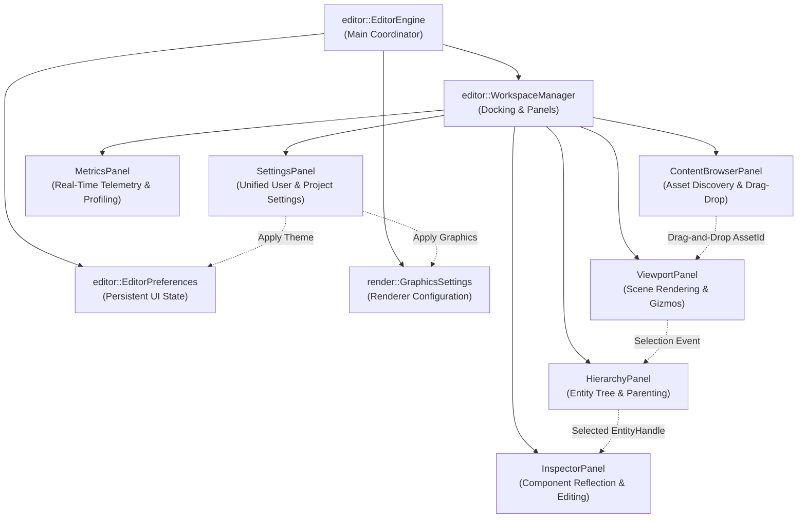
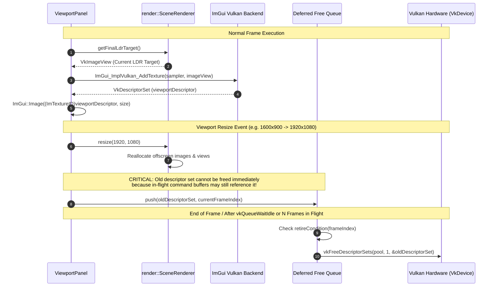
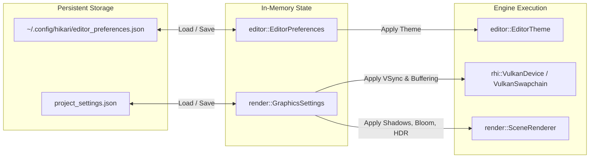

# Hikari Engine Architecture: Editor & UI Subsystem Architecture

**Document ID:** `ARCH-EDIT-2026-REV1`  
**Governing Standard:** Repository Contract [`/AGENTS.md`](../../AGENTS.md)  
**Parent Document:** [`hikari_engine_architecture.md`](hikari_engine_architecture.md)  
**Related Documents:** [`hikari_rendering_architecture.md`](hikari_rendering_architecture.md), [`hikari_application_lifecycle.md`](hikari_application_lifecycle.md), [`hikari_resource_lifetime_and_ownership.md`](hikari_resource_lifetime_and_ownership.md)  

---

## 1. Overview & Architectural Role

The Hikari Editor provides a fully integrated, multi-panel authoring environment built using **Dear ImGui (Docking branch)**. 

Per `/AGENTS.md` Rule 11 (Build and Dependencies) and Rule 2.1:
- All editor code resides in `/editor` and is conditionally compiled under the `EDITOR` CMake preprocessor definition.
- A non-editor engine build contains **zero editor code, zero editor headers, and zero Dear ImGui symbols**.
- Dependencies flow strictly from `editor` $\to$ `engine`. No engine header may ever include an editor header.

---

## 2. Editor Architecture & Panel Hierarchy

The editor core is orchestrated by [`editor::EditorEngine`](../../editor/include/editor/editor_engine.h) and [`editor::WorkspaceManager`](../../editor/include/editor/workspace_manager.h).

### Core Editor Subsystems:

1. **`editor::EditorEngine`:**
   - Controls ImGui context lifecycle (`ImGui::CreateContext()`, `ImGui_ImplSDL3_InitForVulkan()`, `ImGui_ImplVulkan_Init()`).
   - Owns the dedicated ImGui Vulkan descriptor pool (`VkDescriptorPool`) sized for font atlases and viewport textures.
   - Dispatches keyboard and mouse input between editor navigation and scene manipulation.

2. **`editor::WorkspaceManager`:**
   - Implements persistent ImGui docking layouts (`imgui.ini`).
   - Registers, toggles, and renders all dockable panels.
   - Synchronizes global editor themes (Hikari Dark, Charcoal Light, Cyberpunk, Classic).

3. **`editor::ViewportPanel`:**
   - Manages the interactive 3D scene viewport.
   - Owns the editor navigation camera (FreeCam / Orbit / Pan).
   - Detects panel resizing and signals `SceneRenderer::resize(w, h)` when dimensions change.
   - Renders 3D transformation gizmos (ImGuizmo) for translating, rotating, and scaling the currently selected entity.

4. **`editor::HierarchyPanel` & `InspectorPanel`:**
   - Visualizes the Flecs entity hierarchy in a tree view.
   - Provides live editing of components (`TransformComponent`, `MeshComponent`, `MaterialComponent`, `LightComponent`, `CameraComponent`).

5. **`editor::SettingsPanel`:**
   - Single unified modal window containing:
     - **Editor Preferences:** Theme selector, UI scale factor, font size, camera sensitivity, auto-save interval.
     - **Graphics Settings:** Resolution scaling, shadow map resolution ($1024/2048/4096$), bloom enable/threshold, tone mapping mode (ACES/Reinhard/Off), VSync (FIFO/Immediate/Mailbox).

---

## 3. Viewport Texture Binding & Deferred Descriptor Lifecycle

Displaying an offscreen Vulkan render target inside an ImGui window requires generating a Vulkan descriptor set (`VkDescriptorSet`) that combines the image view and a linear sampler.

### Critical Regression Root Cause Analysis (Bug A Fix):
- **Prior Bug:** During graphics settings apply or viewport resize, the editor called `vkFreeDescriptorSets()` immediately on the previous viewport texture descriptor set while the GPU was recording or executing draw commands for that frame.
- **Symptom:** Immediate segmentation fault inside Vulkan driver (`vkCmdDrawIndexed` dereferencing invalid descriptor memory).
- **Architectural Solution:** All ImGui texture descriptor sets are registered into a **deferred retirement queue** (`pendingDescriptorFrees_`). A descriptor set is only freed after `rhiDevice->waitIdle()` or when its associated frame fence has completed.

---

## 4. Settings Architecture & Runtime Propagation

Settings are partitioned into persistent user preferences and project graphics configurations:

### Bidirectional Theme Synchronization (Bug B Fix):
- Settings UI edits update the working copy of `EditorPreferences`.
- When "Apply" is triggered, `EditorTheme::apply(prefs.theme)` updates ImGui colors, styles, and font metrics immediately across all panels.
- The new theme is written to persistent storage, guaranteeing identical visual appearance upon subsequent editor launches.
