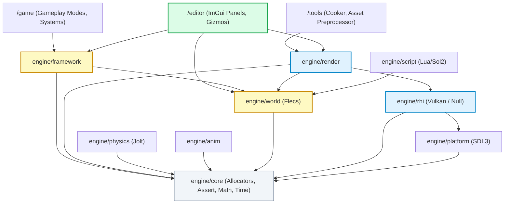

# Hikari Engine: Master Architectural Blueprint & Technical Mapping

**Document ID:** `ARCH-MASTER-2026-REV1`  
**Governing Standard:** Repository Contract [`/AGENTS.md`](../../AGENTS.md)  
**Parent Roadmap:** [`../roadmap/hikari_rendering_evolution_milestone_11.md`](../roadmap/hikari_rendering_evolution_milestone_11.md)  
**Status:** Authoritative Architectural Knowledge Base  
**Date:** November 13, 2026  

---

## 1. Executive Architectural Overview & Engine Philosophy

**Hikari-Machine** is a high-performance C++20 game engine and authoring environment designed for fast-paced 3D action games. The engine is engineered around the core priority order mandated by `/AGENTS.md`:

$$\text{Correctness} \succ \text{Frame-Time Consistency} \succ \text{Input Latency} \succ \text{Simplicity} \succ \text{Features}$$

### Core Architectural Differentiators:
1. **The Conductor and Two Time States:** Rather than maintaining duplicate worlds or pausing the simulation, the engine core is orchestrated by a **Conductor**. It manages exactly **two time states (State A and State B)** over a **single shared World**. While one state is actively ticking gameplay, the standby state incrementally prepares the world-facing setup of the other state within a strict $0.5\text{ ms}$ budget, enabling instantaneous transitions without frame-time spikes.
2. **Strict Layer Boundary Isolation:** All dependencies flow strictly downward: $\text{Game} \to \text{Engine}$, $\text{Editor} \to \text{Engine}$, and $\text{Tools} \to \text{Engine}$. Engine modules never include code from `/game` or `/editor`, nor do they contain game-specific terminology.
3. **Hardware Neutrality with a Dual-GPU Pascal Test Floor:** The development baseline operates on an NVIDIA Pascal test floor (P106-100 discrete render GPU + GT 1030 display GPU). All hardware capability branching is driven by `GpuCaps`, never by vendor names or device IDs.
4. **Deterministic Multi-Rate Execution:** Simulation ticks at a fixed $60\text{ Hz}$ physics timestep with interpolation, while rendering and editor UI execute at the native display refresh rate.

---

## 2. High-Level Engine Architecture Diagram

The diagram below synthesizes the complete subsystem topology, demonstrating how data flows between low-level hardware abstraction, simulation state, rendering, and editor tooling:

```mermaid
graph TB
    subgraph LayerEditor [Editor Layer (Built only with -DEDITOR)]
        EE["editor::EditorEngine"]
        WM["editor::WorkspaceManager"]
        Panels["Editor Panels (Viewport, Hierarchy, Inspector, Content, Settings, Metrics)"]
        EE --> WM --> Panels
    end

    subgraph LayerFramework [Framework Layer]
        RS["framework::RuntimeSession<br/>(Play / Pause / Stop State Machine)"]
        Cond["core::Conductor<br/>(State A Active / State B Standby)"]
    end

    subgraph LayerWorldSimulation [World & Simulation Layer]
        World["world::World<br/>(Flecs ECS / Archetypes)"]
        HierSys["world::HierarchyTransformSystem"]
        Phys["physics::PhysicsWorld<br/>(Jolt Physics 60Hz)"]
        Script["script::ScriptEngine<br/>(Lua 5.4 + Sol2)"]
    end

    subgraph LayerRenderPipeline [Rendering Layer]
        SR["render::SceneRenderer<br/>(Shadow, PBR, Bloom, ToneMap)"]
        AM["render::AssetManager<br/>(FNV-1a 64-bit Cache)"]
        RG["render::RenderGraph<br/>(DAG Compiler - Unit Test Only)"]
    end

    subgraph LayerHardwareAbstraction [Core & Platform Layer]
        Plat["platform::Platform / Window<br/>(SDL3 Backend)"]
        RHI["rhi::Device / VulkanDevice<br/>(Vulkan 1.3 / Null RHI)"]
        VMA["Vulkan Memory Allocator (VMA)"]
        Swap["rhi::VulkanSwapchain"]
    end

    LayerEditor -->|Commands & Viewport Borrow| LayerRenderPipeline
    LayerEditor -->|Select & Inspect Entities| World
    LayerFramework -->|State Isolation & World Clone| World
    LayerRenderPipeline -->|GPU Allocation & Barriers| LayerHardwareAbstraction
    LayerWorldSimulation -->|Physics Bodies| Phys
    LayerRenderPipeline -->|Extract Mesh & Light Data| World
    World --> HierSys
    Plat --> LayerEditor
    RHI --> VMA
    RHI --> Swap
```

---

## 3. Module Dependency Graph & Build Architecture

Hikari enforces strict layer stratification in CMake. A lower layer never links against or includes a higher layer.



### CMake Build Presets & Compile Flags:
- **`debug`:** Optimization off (`-O0`), debug symbols (`-g`), assertions active (`ENG_ASSERT`), validation layers enabled.
- **`release`:** Full optimization (`-O3`), no asserts, validation layers stripped, headless null RHI available.
- **`editor`:** Compiles `/editor` directory and Dear ImGui Vulkan backend (`-DEDITOR`).
- **`asan`:** Compiles with AddressSanitizer and UndefinedBehaviorSanitizer (`-fsanitize=address,undefined`).
- **`tsan`:** Compiles with ThreadSanitizer for job system verification (`-fsanitize=thread`).

---

## 4. Technical Profiles of the 11 Engine Subsystems

### A. Application Lifecycle & Entry Point ([`src/main.cpp`](../../src/main.cpp))
- **Role:** Bootstraps OS platform, initializes Vulkan RHI, instantiates Flecs World, SceneRenderer, and EditorEngine, executes the multi-rate frame loop, and conducts deterministic reverse shutdown.
- **Detailed Audit:** Refer to [`hikari_application_lifecycle.md`](hikari_application_lifecycle.md).

### B. Windowing, Platform & Event Loop ([`engine/platform/`](../../engine/platform/))
- **Role:** Wraps SDL3 for window creation, Vulkan surface instantiation, high-resolution performance timers (`SDL_GetPerformanceCounter`), and keyboard/mouse/gamepad polling.
- **Constraints:** Hot path polling is non-blocking; events are dispatched to ImGui and scene cameras.

### C. Rendering Hardware Interface (RHI) ([`engine/rhi/`](../../engine/rhi/))
- **Role:** Device-level abstraction over Vulkan 1.3/1.4 (`VulkanDevice`, `VulkanSwapchain`, `VulkanCommandList`, `VulkanBuffer`, `VulkanTexture`). Contains a pure `NullDevice` backend for headless CI.
- **Constraints:** Sole location permitted to include `<vulkan/vulkan.h>`.
- **Detailed Audit:** Refer to [`hikari_rendering_architecture.md`](hikari_rendering_architecture.md).

### D. Scene Rendering Pipeline ([`engine/render/`](../../engine/render/))
- **Role:** Executes directional shadow mapping ($2048 \times 2048$), forward PBR shading (Cook-Torrance GGX), 6-level bloom pyramid, and ACES tone mapping to offscreen render targets.
- **Reality Check:** `RenderGraph` is currently disconnected from `SceneRenderer`; passes are executed via hardcoded sequential function calls.
- **Detailed Audit:** Refer to [`hikari_rendering_architecture.md`](hikari_rendering_architecture.md).

### E. ECS & World State ([`engine/world/`](../../engine/world/))
- **Role:** Data backbone wrapping Flecs ECS. Manages entity archetypes, POD component storage, parent-child hierarchies, and JSON scene serialization (`.hikari`).
- **Detailed Audit:** Refer to [`hikari_ecs_world_architecture.md`](hikari_ecs_world_architecture.md).

### F. Conductor & Runtime Modes ([`engine/core/`](../../engine/core/), [`engine/framework/`](../../engine/framework/))
- **Role:** Orchestrates the dual-state runtime architecture (Active vs Standby mode) and Play/Edit state machine isolation via `RuntimeSession`.
- **Detailed Audit:** Refer to [`hikari_ecs_world_architecture.md`](hikari_ecs_world_architecture.md).

### G. Physics Subsystem ([`engine/physics/`](../../engine/physics/))
- **Role:** Encapsulates Jolt Physics. Manages broadphase layers (Moving, NonMoving), collision detection, rigid body simulation, and fixed $60\text{ Hz}$ time accumulator stepping.
- **Constraints:** Simulation synchronizes into `PhysicsTransformComponent` before hierarchy updates.

### H. Asset Pipeline & Resource Management ([`engine/render/include/render/asset_manager.h`](../../engine/render/include/render/asset_manager.h))
- **Role:** 64-bit FNV-1a hashed asset addressing (`AssetId`). Manages CPU memory caches (`MeshData`, `ImageData`), GPU uploads via VMA staging buffers, and fallback resources.
- **Detailed Audit:** Refer to [`hikari_asset_pipeline_architecture.md`](hikari_asset_pipeline_architecture.md).

### I. Scripting Subsystem ([`engine/script/`](../../engine/script/))
- **Role:** Embedded Lua 5.4 scripting via Sol2. Exposes entity manipulation and math types to gameplay scripts without exposing raw engine internals.
- **Constraints:** No per-entity script execution in the hot path.

### J. UI Architecture ([`engine/ui/`](../../engine/ui/), [`editor/`](../../editor/))
- **Role:** Dual-tier UI strategy: RmlUi for in-game HUDs (framework level); Dear ImGui (Docking branch) for editor authoring panels.
- **Detailed Audit:** Refer to [`hikari_editor_architecture.md`](hikari_editor_architecture.md).

### K. Editor Architecture ([`editor/`](../../editor/))
- **Role:** Complete desktop authoring tool with dockable panels (`ViewportPanel`, `HierarchyPanel`, `InspectorPanel`, `ContentBrowserPanel`, `SettingsPanel`, `MetricsPanel`).
- **Detailed Audit:** Refer to [`hikari_editor_architecture.md`](hikari_editor_architecture.md).

---

## 5. End-to-End Cross-Subsystem Workflows

### Workflow 1: Scene Loading & Entity Spawning
1. User selects `.hikari` file in `ContentBrowserPanel` or passes `--scene` flag.
2. `world::SceneSerializer::deserializeJson()` clears active Flecs entities.
3. Deserializer reads entity definitions, invokes `world->createEntity(name)`.
4. Attaches `TransformComponent`, `MeshComponent`, `MaterialComponent`, `LightComponent`.
5. For mesh references, `AssetManager::loadMesh()` checks CPU/GPU cache, uploading vertex/index buffers via VMA staging buffers if needed.
6. Reconstructs parent-child `HierarchyComponent` links.
7. `HierarchyTransformSystem::update()` recalculates root-to-leaf world transforms.

### Workflow 2: Main Frame Execution Cycle
1. `src/main.cpp` measures delta time via `SDL_GetPerformanceCounter`.
2. Polls OS events (`platform->pollEvents()`), forwarding input to `EditorEngine`.
3. If Play mode is active, `PhysicsWorld::step(dt)` updates rigid bodies at $60\text{ Hz}$.
4. `HierarchyTransformSystem::update()` updates all entity world matrices.
5. ImGui starts new frame; `EditorEngine::draw()` draws panels.
6. `ViewportPanel` requests scene render; `SceneRenderer` records shadow pass, PBR pass, bloom pyramid, and tone mapping into offscreen LDR target.
7. Offscreen target is displayed inside ImGui viewport window via `ImGui::Image()`.
8. Swapchain command buffer records ImGui draw data and presents backbuffer via `vkQueuePresentKHR`.

### Workflow 3: Viewport Rendering & Editor Integration
1. `ViewportPanel` queries its available pixel rect within the ImGui dockspace.
2. If size changed, invokes `SceneRenderer::resize(w, h)` (with GPU drain via `vkDeviceWaitIdle`).
3. Viewport camera updates view/projection matrices based on mouse/keyboard navigation.
4. Scene rendered to offscreen HDR/LDR target.
5. LDR target's `VkImageView` is registered with ImGui Vulkan backend using `ImGui_ImplVulkan_AddTexture()`.
6. Retired descriptor sets are enqueued into `pendingDescriptorFrees_` to prevent GPU crashes.

### Workflow 4: Transform & Hierarchy Propagation
1. Root entities (entities where `HierarchyComponent::parent == NullEntity`) compute $\mathbf{M}_{\text{world}} = \mathbf{M}_{\text{local}}$.
2. If `PhysicsTransformComponent` is present, it updates local transform before matrix generation.
3. Algorithm traverses children depth-first: $\mathbf{M}_{\text{world}}(\text{child}) = \mathbf{M}_{\text{world}}(\text{parent}) \times \mathbf{M}_{\text{local}}(\text{child})$.
4. Stores computed matrix and world translation/rotation into `WorldTransformComponent`.
5. `SceneRenderer` uses `WorldTransformComponent::worldMatrix` directly as instance model matrix.

### Workflow 5: Play/Pause/Stop Runtime State Machine
1. User clicks "Play" in Editor toolbar: `RuntimeSession::play()` executes.
2. Exact snapshot of `editWorld_` is cloned into `runtimeWorld_`.
3. Jolt physics bodies are instantiated in `PhysicsWorld` for all entities with `PhysicsBodyComponent`.
4. Conductor and Editor point to `runtimeWorld_`.
5. User clicks "Stop": `RuntimeSession::stop()` executes.
6. All Jolt bodies in `PhysicsWorld` are destroyed; `runtimeWorld_` is completely discarded.
7. Conductor and Editor are pointed back to pristine `editWorld_`, guaranteeing zero drift or residual physics corruption.

### Workflow 6: Settings Modification & Runtime Propagation
1. User adjusts graphics or preferences in `SettingsPanel`.
2. User clicks "Apply":
   - **Editor Preferences:** Persisted to `~/.config/hikari/editor_preferences.json`. `EditorTheme::apply()` updates ImGui styles across all panels immediately.
   - **Graphics Settings:** Persisted to `project_settings.json`. `rhiDevice->waitIdle()` drains in-flight GPU commands.
   - Swapchain re-creates if VSync mode changed (`FIFO` vs `MAILBOX`).
   - `SceneRenderer` reallocates shadow map or render targets if shadow resolution or scale changed.

---

## 6. Architectural Reality Check: Planned vs. Actual Codebase

| Feature / System | Architectural Intent | Actual Implementation Reality | Technical Consequence |
|---|---|---|---|
| **Render Graph** | Fully dynamic DAG of passes with automated memory barriers and transient aliasing | **Disconnected.** `RenderGraph` exists and passes unit tests, but `SceneRenderer` hardcodes passes linearly | Manual `VkImageMemoryBarrier` calls; high risk of barrier bugs when adding passes |
| **Frustum Culling** | Hierarchical CPU AABB-frustum culling of mesh instances | **Missing.** `SceneRenderer` iterates all `MeshComponent` entities and renders unconditionally | 206 draw calls & 524k triangles/frame in Sponza; 0% culling efficiency |
| **Depth Pre-Pass** | Early-Z depth-only pass to eliminate overdraw in forward PBR | **Missing.** Geometry rasterized directly into HDR color target | Main PBR pass takes $18.94\text{ ms}$ on Pascal P106-100 due to fragment overdraw |
| **Shadow Cascades** | 4-split Cascaded Shadow Maps (CSM) for large environments | **Single fixed 2048 projection.** Single orthographic box | Extreme perspective aliasing and acne in Sponza |
| **Multi-GPU Topology** | Hardware-neutral single-device submission | **Cross-GPU bus transfer.** Render on P106-100, present on GT 1030 | PCIe latency and presentation overhead |

---

## 7. Strategic Alignment with Milestone 11 Roadmap

This architectural mapping directly underpins the execution of the **Hikari Rendering Evolution (Milestone 11 Series)**:

- **Milestone 11B (Renderer Modernization & Architecture Optimization):**
  - Directly resolves **RISK-01** (Frustum Culling) and **RISK-04** (Depth Pre-Pass), reducing main pass duration from $18.94\text{ ms}$ to within the $10\text{ ms}$ budget.
  - Directly migrates `SceneRenderer` onto **RISK-02** (`RenderGraph`), establishing dynamic barrier compilation.
- **Milestone 11C (Advanced Lighting & Image-Based Lighting):**
  - Connects split-sum GGX environment maps and irradiance probes into the forward PBR pipeline via descriptor set 0.
- **Milestone 11E (Advanced Shadows & Filtering):**
  - Resolves **RISK-03** by replacing the single 2048 shadow projection with 4-cascade CSM and PCSS contact hardening.
- **Milestone 11H (Temporal Super-Resolution & TAA):**
  - Integrates jittered camera matrices and velocity buffers using `WorldTransformComponent` history.

---

## 8. Supporting Architectural Documentation Index

The technical details of each subsystem are comprehensively documented in the following specialized architecture references:

1. [`hikari_application_lifecycle.md`](hikari_application_lifecycle.md)  
   *Deep trace of engine boot, subsystem initialization, multi-rate main loop, and deterministic reverse shutdown sequence.*
2. [`hikari_ecs_world_architecture.md`](hikari_ecs_world_architecture.md)  
   *Flecs ECS integration, component memory taxonomy, parent-child transform propagation, and RuntimeSession Play/Edit state isolation.*
3. [`hikari_rendering_architecture.md`](hikari_rendering_architecture.md)  
   *Vulkan RHI abstraction, SceneRenderer pass pipeline, Cook-Torrance GGX PBR, bloom pyramid, RenderGraph disconnection reality check, and Pascal GPU bottlenecks.*
4. [`hikari_asset_pipeline_architecture.md`](hikari_asset_pipeline_architecture.md)  
   *64-bit FNV-1a asset addressing, CPU/GPU cache layout, VMA staging buffer upload pipeline, and deterministic fallback resources.*
5. [`hikari_editor_architecture.md`](hikari_editor_architecture.md)  
   *Dear ImGui docking workspace, panel registry, viewport texture binding, deferred descriptor cleanup queue (Bug A fix), and bidirectional theme synchronization (Bug B fix).*
6. [`hikari_resource_lifetime_and_ownership.md`](hikari_resource_lifetime_and_ownership.md)  
   *Comprehensive ownership matrix, VMA memory management, frame-in-flight fences, and GPU resource synchronization.*
7. [`hikari_architecture_risk_register.md`](hikari_architecture_risk_register.md)  
   *Prioritized architectural risk register detailing Risk IDs, failure modes, severity rankings, and Milestone 11 blocker status.*
