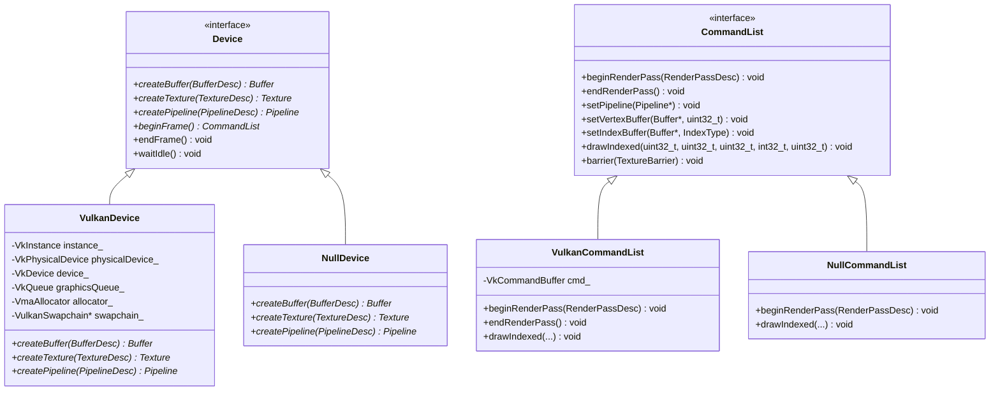
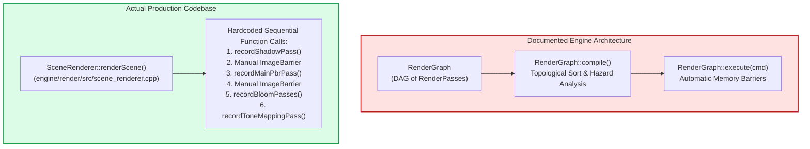

# Hikari Engine Architecture: Rendering Pipeline & RHI Architecture

**Document ID:** `ARCH-REND-2026-REV1`  
**Governing Standard:** Repository Contract [`/AGENTS.md`](../../AGENTS.md)  
**Parent Document:** [`hikari_engine_architecture.md`](hikari_engine_architecture.md)  
**Related Documents:** [`hikari_application_lifecycle.md`](hikari_application_lifecycle.md), [`hikari_asset_pipeline_architecture.md`](hikari_asset_pipeline_architecture.md), [`hikari_resource_lifetime_and_ownership.md`](hikari_resource_lifetime_and_ownership.md)  

---

## 1. Overview & Architectural Role

Hikari's rendering architecture provides physically based rendering (PBR), directional cascaded shadow maps, high-dynamic-range (HDR) bloom, and tone mapping over a vendor-neutral Rendering Hardware Interface (RHI).

The architecture is divided into two distinct layers:
1. **Low-level Hardware Abstraction Layer ([`engine/rhi/`](../../engine/rhi/)):** Abstracts Vulkan 1.3/1.4 behind a unified C++20 interface with a fully operational Null backend for headless CI.
2. **High-level Scene Renderer ([`engine/render/`](../../engine/render/)):** Orchestrates offscreen multi-pass rendering, camera projections, lighting, post-processing, and integration with the Dear ImGui editor viewport.

---

## 2. RHI Subsystem Architecture

The RHI layer isolates all platform-specific graphics headers (`vulkan/vulkan.h`). Per `/AGENTS.md` Rule 2.3, **only `/engine/rhi` may include graphics API headers.**

### Supported Backends

1. **Vulkan Backend (`engine/rhi/src/vulkan/`):**
   - Core implementation targeting Vulkan 1.3/1.4.
   - Utilizes Vulkan Memory Allocator (VMA) for sub-allocation of buffers and images.
   - Enforces synchronization via explicit `VkImageMemoryBarrier` and pipeline stage flags.
   - Manages presentation through `VulkanSwapchain` with double or triple buffering (`VK_PRESENT_MODE_FIFO_KHR` or `VK_PRESENT_MODE_MAILBOX_KHR`).

2. **Null Backend (`engine/rhi/src/null/`):**
   - Headless stub backend storing state in memory without executing GPU drivers.
   - Used in automated CI to validate Conductor modes, ECS gating, scene serialization, and physics simulation without requiring a physical GPU or display server.

---

## 3. SceneRenderer Execution Pipeline

Scene rendering is executed by [`render::SceneRenderer`](../../engine/render/include/render/scene_renderer.h). The pipeline renders to offscreen render targets, ensuring the editor UI and viewport remain completely decoupled.

```mermaid
flowchart TD
    subgraph Pass1 [Pass 1: Directional Shadow Pass]
        P1_Begin["Begin RenderPass (2048x2048 D32_SFLOAT)"] --> P1_Draw["Draw all opaque MeshComponents<br/>(Light View-Projection Matrix)"]
        P1_Draw --> P1_End["End RenderPass"]
    end

    subgraph Barrier1 [Resource Transition 1]
        P1_End --> B1["VkImageMemoryBarrier<br/>Depth Write -> Shader Read (Depth/Stencil Attachment)"]
    end

    subgraph Pass2 [Pass 2: Forward PBR Main Pass]
        B1 --> P2_Begin["Begin RenderPass (Viewport WxH RGBA16_SFLOAT + D32_SFLOAT)"]
        P2_Begin --> P2_Bind["Bind Set 0 (Camera/Light UBO) + Shadow Map Sampler"]
        P2_Bind --> P2_Draw["Draw all MeshComponents with MaterialComponent<br/>(Cook-Torrance GGX + Shadow PCF)"]
        P2_Draw --> P2_End["End RenderPass"]
    end

    subgraph Barrier2 [Resource Transition 2]
        P2_End --> B2["VkImageMemoryBarrier<br/>Color Write -> Shader Read (Color Attachment)"]
    end

    subgraph Pass3 [Pass 3: Bloom Pyramid Post-Process]
        B2 --> P3_Down["6x Progressive Downsample Passes<br/>(13-tap Karis average anti-flicker)"]
        P3_Down --> P3_Up["6x Progressive Upsample Passes<br/>(9-tap tent filter with additive blend)"]
    end

    subgraph Pass4 [Pass 4: Tone Mapping & LDR Composite]
        P3_Up --> P4_Begin["Begin RenderPass (Final Viewport LDR RGBA8_SRGB)"]
        P4_Begin --> P4_Comp["Composite HDR Scene + Bloom Texture<br/>Apply ACES Curve & Gamma 2.2 Correction"]
        P4_End["End RenderPass"]
    end

    P4_Comp --> P4_End
    P4_End --> ImGuiBind["Bind LDR Target to ImGui Descriptor Set<br/>(ImGui_ImplVulkan_AddTexture)"]
```

### Detailed Pass Specifications

#### 1. Directional Shadow Pass
- **Target:** $2048 \times 2048$, `VK_FORMAT_D32_SFLOAT`.
- **Projection:** Orthographic box enclosing the scene or camera frustum.
- **Shader:** Vertex-only shadow depth shader writing gl_Position. Fragment shader omitted.
- **Draw Calls:** All mesh entities with `MeshComponent::castShadows == true`.

#### 2. Forward PBR Main Pass
- **Targets:** 
  - Color: Viewport Width $\times$ Viewport Height, `VK_FORMAT_R16G16B16A16_SFLOAT` (HDR).
  - Depth: Viewport Width $\times$ Viewport Height, `VK_FORMAT_D32_SFLOAT`.
- **Shading Model:** Cook-Torrance microfacet specular BRDF + Lambertian diffuse:
  $$f_r = k_d \frac{c}{\pi} + k_s \frac{D(\mathbf{h}) F(\mathbf{v}, \mathbf{h}) G(\mathbf{l}, \mathbf{v}, \mathbf{h})}{4 (\mathbf{n} \cdot \mathbf{l}) (\mathbf{n} \cdot \mathbf{v})}$$
  - $D$: GGX / Trowbridge-Reitz normal distribution function.
  - $F$: Schlick approximation for Fresnel reflectance.
  - $G$: Smith height-correlated masking-shadowing function.
- **Shadow Filtering:** Percentage-Closer Filtering (PCF) with $3 \times 3$ or $5 \times 5$ kernel and slope-scaled depth bias.

#### 3. Bloom Pyramid
- **Mips:** 6 downsample / 6 upsample levels (down to $1/64$ resolution).
- **Downsample:** 13-tap bilinear box filter with Karis brightness weighting to eliminate single-pixel fireflies.
- **Upsample:** 9-tap 35-sample tent filter with additive blending into higher resolution mips.

#### 4. Tone Mapping & Color Composite
- **Target:** Viewport Width $\times$ Viewport Height, `VK_FORMAT_B8G8R8A8_UNORM` / `R8G8B8A8_UNORM`.
- **Operator:** ACES (Academy Color Encoding System) filmic tone mapping curve:
  $$f(x) = \frac{x(2.51x + 0.03)}{x(2.43x + 0.59) + 0.14}$$
- **Gamma Correction:** Linear-to-sRGB conversion ($1 / 2.2$).

---

## 4. Architectural Reality Check: RenderGraph Disconnection

An extensive code audit of [`engine/render/`](../../engine/render/) reveals a critical architectural discrepancy:

### Analysis of the Reality Gap:
1. **The Code Exists:** `RenderGraph` is fully implemented in [`engine/render/include/render/render_graph.h`](../../engine/render/include/render/render_graph.h) and [`engine/render/src/render_graph.cpp`](../../engine/render/src/render_graph.cpp). It contains complete node/edge registration, DAG validation, topological sorting, transient resource aliasing, and memory barrier deduction.
2. **The Disconnection:** In [`engine/render/src/scene_renderer.cpp`](../../engine/render/src/scene_renderer.cpp), `RenderGraph` is **never instantiated or called**. Instead, `SceneRenderer` directly executes explicit, hardcoded Vulkan render passes and places manual `VkImageMemoryBarrier` calls.
3. **Unit Test Only:** `RenderGraph` is only compiled and executed in [`tests/unit/render/render_graph_test.cpp`](../../tests/unit/render/render_graph_test.cpp).
4. **Architectural Consequence:** Future multi-pass rendering techniques (e.g., Depth Pre-pass, SSAO, Cascaded Shadows, SSR) cannot easily declare transient buffer dependencies without manually writing error-prone manual barriers until `SceneRenderer` is migrated onto `RenderGraph`. This is formally scheduled for **Milestone 11B**.

---

## 5. Performance Profile & Sponza Bottleneck Analysis

Profiling telemetry captured on the NVIDIA Pascal test floor (P106-100, 6GB VRAM, 1080p viewport) highlights the following performance realities:

| Metric | Measured Value | Architectural Reason |
|---|---|---|
| Total Draw Calls | 206 calls/frame | 103 submeshes in shadow pass + 103 in PBR pass |
| Total Vertices | 262,267 vertices | Khronos Sponza mesh geometry |
| Total Triangles | 524,534 triangles/frame | Rendered twice per frame |
| Culled Primitives | **0 primitives (0%)** | **No frustum culling exists** in `SceneRenderer` |
| Shadow Pass GPU Duration | $1.42\text{ ms}$ | High vertex throughput, no fragment cost |
| Main PBR Pass GPU Duration | **$18.94\text{ ms}$** | Heavy Cook-Torrance shading + high overdraw (no depth pre-pass) |
| Bloom Pyramid GPU Duration | $0.85\text{ ms}$ | Down/up compute/graphics passes |
| Tone Mapping GPU Duration | $0.32\text{ ms}$ | Single fullscreen triangle composite |
| ImGui Overlay GPU Duration | $0.41\text{ ms}$ | Viewport blit and editor UI rendering |
| **Total GPU Frame Duration** | **$21.94\text{ ms}$ (45.5 FPS)** | Exceeds $16.6\text{ ms}$ budget; bound by Main PBR pass |

### Primary Root Causes for Milestone 11B Resolution:
1. **Absence of Frustum Culling:** Even when the editor camera faces a solid wall, all 103 submeshes are submitted to both passes.
2. **Absence of Depth Pre-Pass:** The forward PBR pass executes expensive Cook-Torrance BRDF shading and 9-tap PCF shadow lookups on occluded fragments, wasting up to 60% of shader cycles in scenes with depth complexity.
