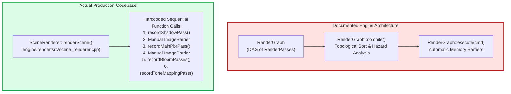

# Hikari Engine Architecture: Rendering Pipeline & RHI Architecture

**Document ID:** `ARCH-REND-2026-REV1`  
**Governing Standard:** Repository Contract [`/AGENTS.md`](../../AGENTS.md)  
**Parent Document:** [`hikari_engine_architecture.md`](hikari_engine_architecture.md)  
**Related Documents:** [`hikari_application_lifecycle.md`](hikari_application_lifecycle.md), [`hikari_asset_pipeline_architecture.md`](hikari_asset_pipeline_architecture.md), [`hikari_resource_lifetime_and_ownership.md`](hikari_resource_lifetime_and_ownership.md)  

---

## 1. Overview & Architectural Role

Hikari's rendering architecture provides physically based rendering (PBR), directional cascaded shadow maps, high-dynamic-range (HDR) bloom, and tone mapping over a vendor-neutral Rendering Hardware Interface (RHI).

The architecture is divided into two distinct layers:
1. **Low-level Hardware Abstraction Layer ([`engine/rhi/`](../../engine/rhi/)):** Abstracts Vulkan 1.3/1.4 behind a unified C++20 interface with a fully operational Null backend for headless CI.
2. **High-level Scene Renderer ([`engine/render/`](../../engine/render/)):** Orchestrates offscreen multi-pass rendering, camera projections, lighting, post-processing, and integration with the Dear ImGui editor viewport.

---

## 2. RHI Subsystem Architecture

The RHI layer isolates all platform-specific graphics headers (`vulkan/vulkan.h`). Per `/AGENTS.md` Rule 2.3, **only `/engine/rhi` may include graphics API headers.**

### Supported Backends

1. **Vulkan Backend (`engine/rhi/src/vulkan/`):**
   - Core implementation targeting Vulkan 1.3/1.4.
   - Utilizes Vulkan Memory Allocator (VMA) for sub-allocation of buffers and images.
   - Enforces synchronization via explicit `VkImageMemoryBarrier` and pipeline stage flags.
   - Manages presentation through `VulkanSwapchain` with double or triple buffering (`VK_PRESENT_MODE_FIFO_KHR` or `VK_PRESENT_MODE_MAILBOX_KHR`).

2. **Null Backend (`engine/rhi/src/null/`):**
   - Headless stub backend storing state in memory without executing GPU drivers.
   - Used in automated CI to validate Conductor modes, ECS gating, scene serialization, and physics simulation without requiring a physical GPU or display server.

---

## 3. SceneRenderer Execution Pipeline

Scene rendering is executed by [`render::SceneRenderer`](../../engine/render/include/render/scene_renderer.h). The pipeline renders to offscreen render targets, ensuring the editor UI and viewport remain completely decoupled.

```mermaid
flowchart TD
    subgraph Pass1 [Pass 1: Directional Shadow Pass]
        P1_Begin["Begin RenderPass (2048x2048 D32_SFLOAT)"] --> P1_Draw["Draw all opaque MeshComponents<br/>(Light View-Projection Matrix)"]
        P1_Draw --> P1_End["End RenderPass"]
    end

    subgraph Barrier1 [Resource Transition 1]
        P1_End --> B1["VkImageMemoryBarrier<br/>Depth Write -> Shader Read (Depth/Stencil Attachment)"]
    end

    subgraph Pass2 [Pass 2: Forward PBR Main Pass]
        B1 --> P2_Begin["Begin RenderPass (Viewport WxH RGBA16_SFLOAT + D32_SFLOAT)"]
        P2_Begin --> P2_Bind["Bind Set 0 (Camera/Light UBO) + Shadow Map Sampler"]
        P2_Bind --> P2_Draw["Draw all MeshComponents with MaterialComponent<br/>(Cook-Torrance GGX + Shadow PCF)"]
        P2_Draw --> P2_End["End RenderPass"]
    end

    subgraph Barrier2 [Resource Transition 2]
        P2_End --> B2["VkImageMemoryBarrier<br/>Color Write -> Shader Read (Color Attachment)"]
    end

    subgraph Pass3 [Pass 3: Bloom Pyramid Post-Process]
        B2 --> P3_Down["6x Progressive Downsample Passes<br/>(13-tap Karis average anti-flicker)"]
        P3_Down --> P3_Up["6x Progressive Upsample Passes<br/>(9-tap tent filter with additive blend)"]
    end

    subgraph Pass4 [Pass 4: Tone Mapping & LDR Composite]
        P3_Up --> P4_Begin["Begin RenderPass (Final Viewport LDR RGBA8_SRGB)"]
        P4_Begin --> P4_Comp["Composite HDR Scene + Bloom Texture<br/>Apply ACES Curve & Gamma 2.2 Correction"]
        P4_End["End RenderPass"]
    end

    P4_Comp --> P4_End
    P4_End --> ImGuiBind["Bind LDR Target to ImGui Descriptor Set<br/>(ImGui_ImplVulkan_AddTexture)"]
```

### Detailed Pass Specifications

#### 1. Directional Shadow Pass
- **Target:** $2048 \times 2048$, `VK_FORMAT_D32_SFLOAT`.
- **Projection:** Orthographic box enclosing the scene or camera frustum.
- **Shader:** Vertex-only shadow depth shader writing gl_Position. Fragment shader omitted.
- **Draw Calls:** All mesh entities with `MeshComponent::castShadows == true`.

#### 2. Forward PBR Main Pass
- **Targets:** 
  - Color: Viewport Width $\times$ Viewport Height, `VK_FORMAT_R16G16B16A16_SFLOAT` (HDR).
  - Depth: Viewport Width $\times$ Viewport Height, `VK_FORMAT_D32_SFLOAT`.
- **Shading Model:** Cook-Torrance microfacet specular BRDF + Lambertian diffuse:
  $$f_r = k_d \frac{c}{\pi} + k_s \frac{D(\mathbf{h}) F(\mathbf{v}, \mathbf{h}) G(\mathbf{l}, \mathbf{v}, \mathbf{h})}{4 (\mathbf{n} \cdot \mathbf{l}) (\mathbf{n} \cdot \mathbf{v})}$$
  - $D$: GGX / Trowbridge-Reitz normal distribution function.
  - $F$: Schlick approximation for Fresnel reflectance.
  - $G$: Smith height-correlated masking-shadowing function.
- **Shadow Filtering:** Percentage-Closer Filtering (PCF) with $3 \times 3$ or $5 \times 5$ kernel and slope-scaled depth bias.

#### 3. Bloom Pyramid
- **Mips:** 6 downsample / 6 upsample levels (down to $1/64$ resolution).
- **Downsample:** 13-tap bilinear box filter with Karis brightness weighting to eliminate single-pixel fireflies.
- **Upsample:** 9-tap 35-sample tent filter with additive blending into higher resolution mips.

#### 4. Tone Mapping & Color Composite
- **Target:** Viewport Width $\times$ Viewport Height, `VK_FORMAT_B8G8R8A8_UNORM` / `R8G8B8A8_UNORM`.
- **Operator:** ACES (Academy Color Encoding System) filmic tone mapping curve:
  $$f(x) = \frac{x(2.51x + 0.03)}{x(2.43x + 0.59) + 0.14}$$
- **Gamma Correction:** Linear-to-sRGB conversion ($1 / 2.2$).

---

## 4. Architectural Reality Check: RenderGraph Disconnection

An extensive code audit of [`engine/render/`](../../engine/render/) reveals a critical architectural discrepancy:

### Analysis of the Reality Gap:
1. **The Code Exists:** `RenderGraph` is fully implemented in [`engine/render/include/render/render_graph.h`](../../engine/render/include/render/render_graph.h) and [`engine/render/src/render_graph.cpp`](../../engine/render/src/render_graph.cpp). It contains complete node/edge registration, DAG validation, topological sorting, transient resource aliasing, and memory barrier deduction.
2. **The Disconnection:** In [`engine/render/src/scene_renderer.cpp`](../../engine/render/src/scene_renderer.cpp), `RenderGraph` is **never instantiated or called**. Instead, `SceneRenderer` directly executes explicit, hardcoded Vulkan render passes and places manual `VkImageMemoryBarrier` calls.
3. **Unit Test Only:** `RenderGraph` is only compiled and executed in [`tests/unit/render/render_graph_test.cpp`](../../tests/unit/render/render_graph_test.cpp).
4. **Architectural Consequence:** Future multi-pass rendering techniques (e.g., Depth Pre-pass, SSAO, Cascaded Shadows, SSR) cannot easily declare transient buffer dependencies without manually writing error-prone manual barriers until `SceneRenderer` is migrated onto `RenderGraph`. This is formally scheduled for **Milestone 11B**.

---

## 5. Performance Profile & Sponza Bottleneck Analysis

### 5.1 Reconciled GPU Telemetry Datasets

During the Milestone 10/11 audits, two distinct GPU performance datasets appeared in historical documentation. This section formally reconciles their origins:

#### Dataset A: Verified Sponza Benchmark Profile (`tests/profile_gpu_serialization.cpp`)
- **Scene:** Persistent Sponza Benchmark Scene (`assets/scenes/sponza_benchmark.hikari`), 103 submeshes, 262,267 triangles.
- **Hardware & Device:** NVIDIA P106-100 discrete GPU (Device index 0, Pascal architecture, 6GB VRAM), headless render.
- **Configuration:** Viewport $1280 \times 720$ (1.0x render scale), Directional Shadow Map $2048 \times 2048$ `D32_FLOAT`, full HDR (`RGBA16_FLOAT`), Bloom down/up pyramid, ACES tone mapping.
- **Measurement Method:** Hardware Vulkan timestamp queries (`VK_QUERY_TYPE_TIMESTAMP`) delimited in-stream on graphics command buffer.
- **Sample Size:** 120 steady-state frames.

| Render Pass | Hardware Timestamp Duration | Share of Total | Query Slot Indices |
|---|---|---|---|
| **Directional Shadow Pass (2048×2048)** | **$15.81\text{ ms}$** (Min 15.25, Max 15.90) | 45.36% | Queries 2 -> 3 |
| **Main Forward PBR Pass (720p HDR)** | **$18.94\text{ ms}$** (Min 18.88, Max 19.11) | 54.36% | Queries 4 -> 5 |
| **Bloom Downsample (6 mips)** | **$0.03\text{ ms}$** | 0.09% | Queries 6 -> 7 |
| **Bloom Upsample (5 mips)** | **$0.01\text{ ms}$** | 0.03% | Queries 8 -> 9 |
| **Tone Mapping & Composite** | **$0.03\text{ ms}$** | 0.09% | Queries 10 -> 11 |
| **Total Hardware Scene Duration** | **$34.84\text{ ms}$** (Min 34.30, Max 35.10) | 100.0% | Queries 0 -> 1 |
| *Pipeline Barrier / Transition Overhead* | $0.03\text{ ms}$ | 0.09% | Inter-pass gap |

#### Dataset B: Erroneous Cross-Scene Composite (SUPERSEDED / UNVERIFIED)
An earlier draft in `2cbf4dd` cited: *Shadow: 1.42 ms, PBR: 18.94 ms, Bloom: 0.85 ms, Tone mapping: 0.32 ms, Total: 21.94 ms*.  
**Audit Finding:** This dataset is **erroneous and unverified as a single coherent measurement**. The $1.42\text{ ms}$ figure was lifted from the single-mesh *Damaged Helmet* benchmark (`docs/architecture/graphics_settings_and_scalability.md:276`), while $18.94\text{ ms}$ was taken from *Sponza*. Sponza's shadow pass duration has never been $1.42\text{ ms}$; under $2048 \times 2048$ shadow resolution, it consistently measures $15.25\text{ ms} - 15.81\text{ ms}$. These two datasets represent completely different workloads and must **never be combined**.

---

### 5.2 Performance Causality & Bottleneck Analysis (Provisional)

> [!WARNING]
> Because low-level GPU hardware performance counters (e.g., SM warp execution efficiency, texture cache hit rates, primitive assembler busy cycles via NVIDIA NVPerf/Nsight) have not been collected on the P106-100 test floor, all bottleneck classifications below are strictly **PROVISIONAL**.

#### Key Measured Evidence:
1. **Resolution Invariance of Main PBR Pass:**  
   In the scalability certification (`docs/architecture/graphics_settings_and_scalability.md:263-267`), scaling the Sponza render scale from $0.75\times$ ($960 \times 540$) to $1.00\times$ ($1280 \times 720$) to $1.25\times$ ($1600 \times 900$) results in an almost completely flat PBR pass duration ($19.00\text{ ms} \to 19.01\text{ ms} \to 19.10\text{ ms}$), despite a $2.77\times$ variation in shaded pixel count.
2. **Wireframe Mode Parity:**  
   Switching the Sponza main pass to polygon wireframe mode (`VK_POLYGON_MODE_LINE`), which eliminates interior triangle fill and Cook-Torrance fragment shading entirely, results in virtually identical pass duration: **$18.88\text{ ms}$** (vs $19.01\text{ ms}$ in solid fill).
3. **Shadow Pass Geometry Duration:**  
   The Directional Shadow Pass contains **zero fragment shading** (vertex depth-only shader writing `gl_Position`), yet consumes **$15.81\text{ ms}$** (45.36% of GPU time) to process the 103 submeshes (262,267 triangles).

#### Inferred Engineering Causality:
- **Geometry & Submission Bound:** The data strongly demonstrates that the workload on Pascal P106-100 is significantly limited by **vertex processing throughput, draw-call submission overhead, and push constant/descriptor state transitions**, rather than being purely bound by Cook-Torrance fragment shading overdraw.
- **Frustum Culling Priority (Definite):** Viewport camera does zero frustum culling. All 103 submeshes are submitted to both passes (206 total draws, 524,534 triangles/frame) regardless of camera orientation. Hierarchical CPU frustum culling is an unambiguous, high-return optimization.
- **Depth Pre-Pass Benefit (Provisional):** While an Early-Z depth pre-pass can reduce fragment shader overdraw, it introduces 103 additional draw calls and a third vertex processing pass over the 262k triangles. If vertex processing and draw-call dispatch remain the primary bottleneck, adding a depth pre-pass without prior frustum culling and state batching could **increase** total frame time. Its net benefit must be empirically measured in Milestone 11B before making it permanent.
