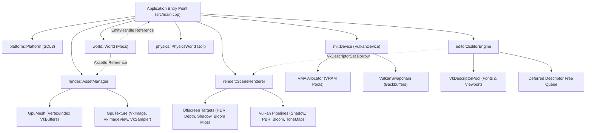
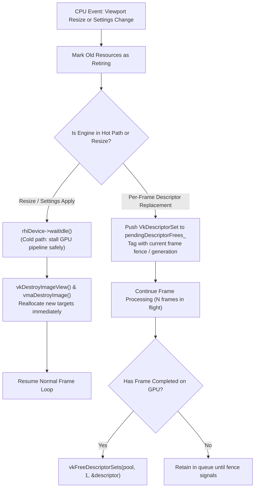

# Hikari Engine Architecture: Resource Lifetime, Ownership & Synchronization

**Document ID:** `ARCH-RES-2026-REV1`  
**Governing Standard:** Repository Contract [`/AGENTS.md`](../../AGENTS.md) Section 5 (Memory Management)  
**Parent Document:** [`hikari_engine_architecture.md`](hikari_engine_architecture.md)  
**Related Documents:** [`hikari_application_lifecycle.md`](hikari_application_lifecycle.md), [`hikari_rendering_architecture.md`](hikari_rendering_architecture.md), [`hikari_asset_pipeline_architecture.md`](hikari_asset_pipeline_architecture.md)  

---

## 1. Overview & Architectural Role

Hikari strictly adheres to `/AGENTS.md` Rule 5 (Memory Management):
- **Single Clear Ownership:** Every heap or GPU resource has exactly one owning object. Ownership is encoded in types (`std::unique_ptr`, owning manager classes), never in comments.
- **No Shared Pointers:** `std::shared_ptr` is prohibited in engine code. Non-owning access is granted exclusively through references, `std::span`, `std::string_view`, or generational handles (`AssetId`, `EntityHandle`).
- **No Raw Allocations:** Raw `new`/`delete` and `malloc`/`free` are forbidden in engine code.
- **GPU Synchronization First:** No GPU resource is freed while referenced by in-flight command buffers.

---

## 2. Comprehensive Resource Ownership Matrix

The following matrix documents the complete lifecycle, ownership, invalidation triggers, and destruction strategies for every resource across Hikari Engine:

| Resource Type | Creator | Primary Owner | Non-Owning Borrowers | Invalidation Triggers | Destroyer | Strategy | GPU Sync Required |
|---|---|---|---|---|---|---|---|
| **ECS World** | `src/main.cpp` | `main()` / `RuntimeSession` | Systems, Panels, Renderer | Scene reload, Play/Edit switch, Shutdown | Scope termination | Immediate | None |
| **ECS Entities** | `SceneSerializer` / Importers | `world::World` (Flecs) | `EntityHandle` references | Scene clear, entity destruction | `World::destroyEntity()` | Deferred (end of tick) | None |
| **Vulkan Device & Instance** | `rhi::createVulkanDevice` | `main()` (`std::unique_ptr`) | All RHI resources | Engine shutdown | `VulkanDevice::~VulkanDevice` | Immediate at exit | `device->waitIdle()` |
| **Vulkan Swapchain** | `VulkanDevice` | `VulkanDevice` | Window, ImGui presenter | Window resize, VSync toggle, display change | `VulkanDevice::recreateSwapchain` | Immediate after drain | `vkDeviceWaitIdle` |
| **GPU Buffers (Vertex/Index)** | `AssetManager` | `AssetManager` (`GpuMesh`) | `MeshComponent`, CommandList | Asset unload, cache clear, shutdown | `AssetManager::unloadMesh` | Immediate | Must not be in-flight |
| **GPU Textures & Views** | `AssetManager` | `AssetManager` (`GpuTexture`) | `MaterialComponent`, Shaders | Asset unload, cache clear, shutdown | `AssetManager::unloadTexture` | Immediate | Must not be in-flight |
| **GPU Samplers** | `AssetManager` / `SceneRenderer` | Owning subsystem | Shaders, ImGui backend | Settings change (filtering), shutdown | Owner destructor | Immediate | Must not be in-flight |
| **Vulkan Pipelines** | `SceneRenderer` | `SceneRenderer` | `CommandList` execution | Shader reload, pipeline config, shutdown | `SceneRenderer::~SceneRenderer` | Immediate | Must not be in-flight |
| **Offscreen Render Targets** | `SceneRenderer` | `SceneRenderer` | ViewportPanel, Pass descriptors | Viewport resize, HDR/Shadow settings apply | `SceneRenderer::resizeTargets` | Immediate after drain | `vkDeviceWaitIdle` |
| **ImGui Viewport Descriptors** | `ViewportPanel` | `editor::EditorEngine` | `ImGui::Image` drawing | Viewport resize, Target recreation | `EditorEngine` deferred queue | **Deferred** (`pendingDescriptorFrees_`) | Complete frame fence |
| **Jolt Physics Bodies** | `RuntimeSession` | `physics::PhysicsWorld` | `PhysicsBodyComponent` | Entity removal, Play mode exit | `PhysicsWorld::destroyBody` | Immediate | None |
| **Lua Script State** | `ScriptEngine` | `ScriptEngine` | Script systems | Hot reload, mode reset, shutdown | `ScriptEngine::~ScriptEngine` | Immediate | None |

---

## 3. Resource Ownership Hierarchy Diagram

---

## 4. Multi-Frame GPU Synchronization & Deferred Invalidation

Vulkan command lists execute asynchronously on the GPU. When a resource is modified, resized, or destroyed on the CPU thread, Hikari enforces strict GPU safety rules.

### Frame-In-Flight Synchronization Primitives
1. **Per-Frame Semaphores:**
   - `imageAvailableSemaphore_`: Signaled when `vkAcquireNextImageKHR` acquires a swapchain backbuffer.
   - `renderFinishedSemaphore_`: Signaled when the graphics command list finishes execution, consumed by `vkQueuePresentKHR`.
2. **Per-Frame Fences (`VkFence`):**
   - Each frame in flight has a fence signaled upon GPU command completion.
   - `vkWaitForFences()` is invoked at the start of the next iteration of that frame slot before recycling its command buffer.
3. **Pipeline Image Barriers (`VkImageMemoryBarrier`):**
   - Enforce execution and memory dependencies between consecutive passes (Shadow write $\to$ PBR fragment read; PBR color write $\to$ Bloom compute read; Bloom write $\to$ Tone mapping composite read).
