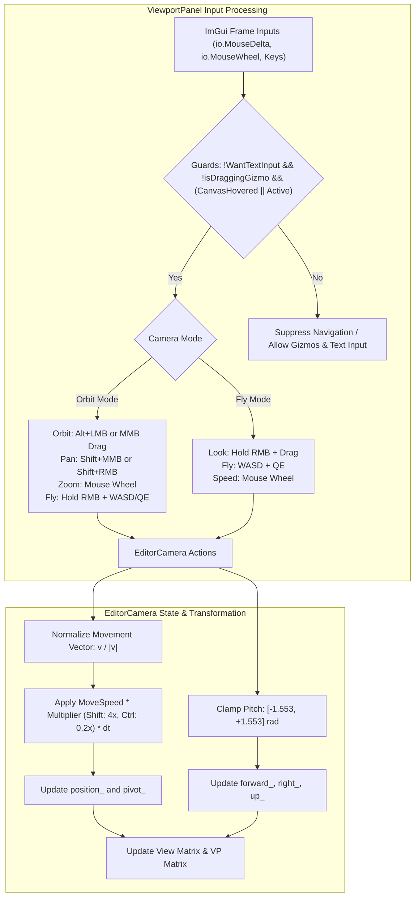

# Milestone 8B.4 Architecture: Editor Camera Navigation & Viewport Interaction

## 1. Executive Summary

Milestone 8B.4 establishes a complete, robust, professional 3D editor camera navigation system inside the Dear ImGui Scene Viewport of Hikari-Machine.

Prior to this milestone, editor camera controls were limited to basic orbit and pan maneuvers with unnormalized movement, lack of distinct navigation modes, and missing input ownership guards. Milestone 8B.4 delivers:

1. **Intuitive WASD + QE Fly Navigation**: 6-degree-of-freedom first-person camera movement oriented along the camera's local forward, right, and world up axes.
2. **Diagonal Movement Normalization**: Normalizes non-zero local movement vectors to unit length, preventing diagonal movement from traveling $\sqrt{2}\times$ or $\sqrt{3}\times$ faster than cardinal movement.
3. **Smooth Mouse Look & Singularity Protection**: First-person looking orientation driven by right mouse drag with pitch angle clamping ($[-89^\circ, +89^\circ]$) to eliminate gimbal flips, and mouse delta suppression on navigation start to prevent orientation jumps.
4. **Speed Scaling & Precision Modifiers**: Normal speed (5.0 m/s default), fast speed (Shift: 4.0x / 20.0 m/s), precision speed (Ctrl: 0.2x / 1.0 m/s), and dynamic scroll wheel speed adjustment in Fly mode.
5. **Strict Input Ownership & UI Safety**: Zero interference with text input fields (`ImGuiIO::WantTextInput`), transform gizmo manipulation (`s_isDraggingGizmo`), entity selection, ray picking, or viewport docking.
6. **Orbit & Fly Camera Modes**: Mode-based camera execution toggled via toolbar button (`[Cam: Orbit]` / `[Cam: Fly]`), complete with status reporting and interactive control hints.
7. **Unobtrusive Viewport UX**: Integrated diagnostic HUD card communicating active camera mode, real-time navigation status badge `[NAV]`, and effective movement speed.

---

## 2. Navigation Architecture

### 2.1 Coordinate Conventions & View Transform

- **World Up**: `Vec3{0.0F, 1.0F, 0.0F}` ($+Y$).
- **Forward Vector**: Computed from spherical coordinates:
  $$\text{forward} = (\cos(\text{pitch}) \sin(\text{yaw}), \sin(\text{pitch}), \cos(\text{pitch}) \cos(\text{yaw}))$$
- **Right Vector**:
  $$\text{right} = (\cos(\text{yaw}), 0, -\sin(\text{yaw}))$$
- **Camera Up Vector**:
  $$\text{up} = \text{right} \times \text{forward}$$
- **View Matrix**: Built using right-handed look-at matrix where forward points down the negative Z axis in eye space.

---

## 3. Input Ownership & Interaction Safety

### 3.1 Text Input Isolation (`io.WantTextInput`)
When any ImGui widget (e.g. text input fields in the Inspector, Console, Scene Hierarchy rename, or Content Browser) captures keyboard focus, `io.WantTextInput` evaluates to `true`.
Under this condition:
- WASD, Q, and E navigation is completely suppressed.
- Hotkeys (W for translate gizmo, E for rotate gizmo, R for scale gizmo, G for grid toggle, F for framing) are inhibited.
- The camera position and orientation remain entirely static.

### 3.2 Gizmo Dragging Isolation (`s_isDraggingGizmo`)
When the user clicks or drags any axis or plane of the transform gizmo:
- `s_isDraggingGizmo` is asserted.
- Camera orbit, pan, fly, and zoom inputs are disabled.
- Mouse movement is exclusively dedicated to transform manipulation.

### 3.3 Jump Prevention on Navigation Start
When right mouse button is pressed to initiate first-person looking, the accumulated `io.MouseDelta` from frames before the click can cause an abrupt camera snap.
To prevent this:
- `ViewportPanel` maintains `static bool s_wasLooking = false;`.
- On the initial frame where RMB transition to down occurs, `s_wasLooking` is set to `true` while mouse delta rotation is skipped.
- On subsequent frames while held, `camera_.look(io.MouseDelta.x, io.MouseDelta.y)` applies smooth, continuous delta updates.
- When RMB is released, `s_wasLooking` resets to `false`.

---

## 4. Control Schemes

### 4.1 Orbit Mode (Default)

| Input Action | Result |
| :--- | :--- |
| **Alt + Left Mouse Drag** | Orbit around focal pivot point |
| **Middle Mouse Drag** | Orbit around focal pivot point |
| **Shift + Middle Mouse Drag** | Pan parallel to viewport view plane |
| **Shift + Right Mouse Drag** | Pan parallel to viewport view plane |
| **Mouse Wheel** | Zoom toward / away from focal pivot point |
| **Hold Right Mouse + WASD** | Seamless first-person fly movement |
| **Hold Right Mouse + Q / E** | Fly vertically downward ($Q$) or upward ($E$) |
| **F Key** | Focus/frame camera on selected entity (or world origin) |
| **W / E / R Keys** | Switch active gizmo between Translate, Rotate, and Scale |
| **G Key** | Toggle perspective ground grid visibility |

### 4.2 Fly Mode

| Input Action | Result |
| :--- | :--- |
| **W / S Keys** | Fly forward / backward along camera orientation |
| **A / D Keys** | Fly left / right along camera right axis |
| **Q / E Keys** | Fly downward / upward along world vertical axis |
| **Hold Right Mouse + Drag** | Look around (first-person pitch and yaw) |
| **Shift Key (Held)** | Fast speed multiplier ($4.0\times \rightarrow 20.0\text{ m/s}$) |
| **Ctrl Key (Held)** | Precision speed multiplier ($0.2\times \rightarrow 1.0\text{ m/s}$) |
| **Mouse Wheel** | Dynamically adjust base flight speed ($[0.5, 100.0]\text{ m/s}$) |
| **R Key** | Switch active gizmo to Scale (when not flying) |
| **G Key** | Toggle perspective ground grid visibility |
| **F Key** | Focus/frame camera on selected entity (when not looking) |

---

## 5. Architectural Integrity & Isolation

1. **ECS Independence**: `EditorCamera` resides exclusively in the `eng::editor` namespace within `editor/include/editor/editor_camera.h` and `editor/src/editor_camera.cpp`. It does not modify, reference, or serialize entity components.
2. **Two-State Conductor Preservation**: The generic Active/Standby Conductor state identity is unaffected. Camera navigation functions identically in both State A (Active) and State B (Standby).
3. **Runtime World Isolation**: Interactive camera navigation functions seamlessly while runtime simulations are active, paused, or running without contaminating the runtime ECS world or scene snapshot.
4. **Dual Rendering Compatibility**: Camera view and projection matrices feed both the GPU Vulkan dynamic rendering pipeline (`SceneRenderer`) and the CPU wireframe rasterizer fallback.

---

## 6. Verification & Test Suite

A comprehensive 14-point regression suite was added to `tests/unit/editor/editor_test.cpp` via `testEditorCameraNavigationAndFlyMode()`:

1. **Forward & Backward Movement**: Validates exact displacement along forward vector ($+5.0\text{m}$ / $-5.0\text{m}$).
2. **Left & Right Movement**: Validates exact displacement along right vector ($+5.0\text{m}$ / $-5.0\text{m}$).
3. **Vertical Movement**: Validates exact vertical elevation along $+Y$ ($+5.0\text{m}$) and $-Y$ ($-5.0\text{m}$).
4. **Diagonal Normalization**: Verifies that compound diagonal input ($\text{Right} + \text{Forward}$, magnitude $\sqrt{2}$) yields a normalized displacement of exactly $5.0\text{m}$, not $7.071\text{m}$.
5. **Delta-Time Independence**: Verifies that 10 steps of $\Delta t = 0.1\text{s}$ produce displacement identical to 1 step of $\Delta t = 1.0\text{s}$.
6. **Shift Multiplier**: Confirms $4.0\times$ speed factor ($20.0\text{ m/s}$).
7. **Ctrl Multiplier**: Confirms $0.2\times$ speed factor ($1.0\text{ m/s}$).
8. **Mouse Look & Pitch Clamping**: Verifies yaw/pitch response and asserts pitch boundary adherence within $[-1.553, +1.553]\text{ rad}$ ($\pm 89^\circ$).
9. **Orbit / Fly Mode Switching**: Verifies mode toggling and state queries.
10. **Navigation Activation Tracking**: Verifies `isNavigating()` state transitions.
11. **Input Capture Protection**: Validates that active text input (`WantTextInput`) or gizmo dragging halts camera motion.
12. **ECS Transform Independence**: Confirms entity transforms in ECS remain unmodified after extensive camera flight and orbit.
13. **Framing & Orbit Stability**: Verifies pivot preservation during orbit and distance framing calculations.
14. **Speed Adjustment & Clamping**: Verifies scroll speed adjustment and clamping to $[0.5, 100.0]\text{ m/s}$.

### Multi-Preset Results

| Preset | Target Type | Result | Test Suite Time |
| :--- | :--- | :--- | :--- |
| **editor** | Debug with Editor UI | **33 / 33 PASSED** | 3.26 s |
| **debug** | Standalone Debug | **32 / 32 PASSED** | 2.46 s |
| **release** | Optimized Release | **32 / 32 PASSED** | 1.92 s |
| **profile** | Profiling Build | **32 / 32 PASSED** | 1.85 s |
| **asan** | AddressSanitizer + UB | **32 / 32 PASSED** | 35.41 s |
| **tsan** | ThreadSanitizer | **32 / 32 PASSED** | 1.89 s |

### Physical GUI Verification
- Executed `./build/editor/bin/hikari --frames 180`.
- Verified physical Vulkan swapchain presentation, dynamic rendering pass execution, ImGui viewport image sampling, and clean teardown over 180 continuous frames without memory leaks, validation layer messages, or segmentation faults.
