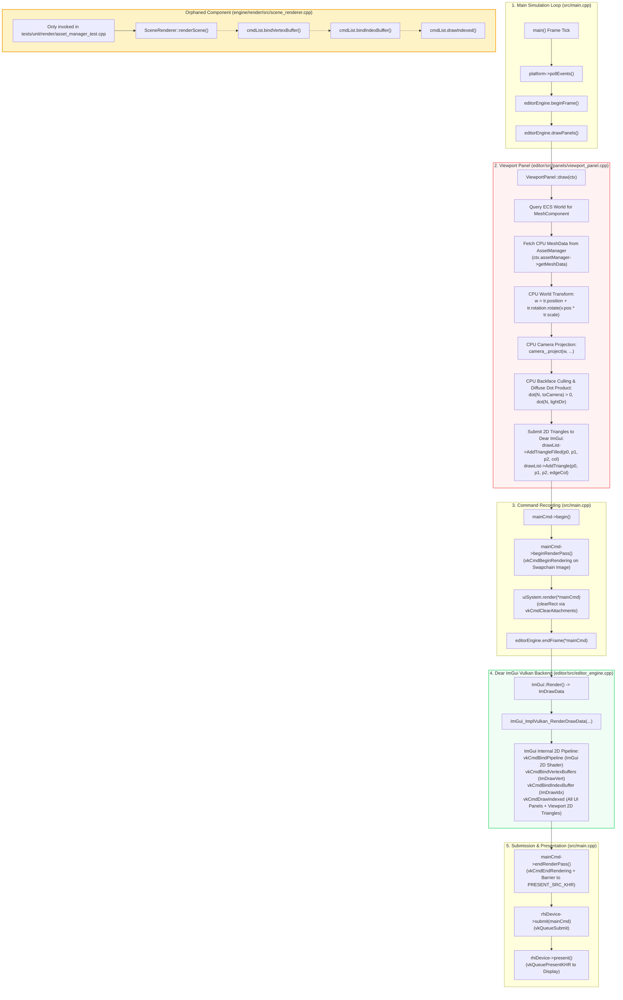

# Hikari-Machine: Milestone 7.5 Technical Audit Report
## Rendering Pipeline Reality Check & GPU Rendering Audit

**Date:** 2026-11-08  
**Repository:** `/home/user/hikari-machine`  
**Milestone:** 7.5 — Rendering Pipeline Reality Check  
**Author:** Antigravity (Advanced Agentic Coding Assistant)  
**Status:** Complete — Audit Only (No production modifications, no commits)  

---

## A. Executive Summary

A comprehensive investigation of the Hikari codebase was conducted to determine the exact execution path taken when a 3D mesh appears in the Scene Viewport.

### Key Finding:
**Hikari does NOT currently render 3D meshes through a GPU graphics pipeline.**

While GPU resource infrastructure ([`GpuMesh`](engine/render/include/render/gpu_mesh.h), [`RhiDevice::createBuffer`](engine/rhi/src/vulkan/vulkan_device.cpp#L289-L346), and [`RhiDevice::writeBuffer`](engine/rhi/src/vulkan/vulkan_device.cpp#L366-L389)) genuinely allocates Vulkan `VkBuffer` memory on the GPU and uploads vertex/index data into host-visible GPU memory, **these GPU buffers are never bound or read by any graphics pipeline during viewport rendering.**

Instead, the Scene Viewport visualizes 3D meshes via **CPU-side software projection and 2D vector triangle rendering through Dear ImGui's draw list** ([`ImDrawList`](editor/src/panels/viewport_panel.cpp#L349-L432)):
1. The viewport panel retrieves the CPU copy of the mesh geometry ([`MeshData`](engine/render/include/render/mesh.h)) directly from system RAM.
2. The CPU performs world transformation, camera projection, backface culling, and flat diffuse lighting for every triangle.
3. The resulting 2D screen-space triangles are submitted to Dear ImGui (`drawList->AddTriangleFilled`), which rasterizes them using ImGui's internal 2D UI shader.
4. The [`SceneRenderer`](engine/render/src/scene_renderer.cpp) class (which records `bindVertexBuffer` and `drawIndexed` to `RhiCommandList`) is **completely disconnected** from both the editor and the engine runtime loop; it is invoked solely inside a unit test.
5. Hikari's RHI currently lacks shader module management, pipeline layout creation, and graphics pipeline state objects (`VkPipeline`).

---

## B. Actual Rendering Architecture

The diagram below details the actual frame rendering path executed by `hikari` (`src/main.cpp`):



---

## C. Vulkan Capability Matrix

The table below summarizes Vulkan rendering capabilities across Hikari's codebase, distinguishing between what is implemented and what is actually called by the viewport:

| Capability | Implemented in RHI | Called by Viewport / Engine Loop | Evidence & Location |
| :--- | :---: | :---: | :--- |
| **Vertex Buffers** | **YES** | **NO** | [`VulkanDevice::createBuffer`](engine/rhi/src/vulkan/vulkan_device.cpp#L289-L346) calls `vkCreateBuffer` (`VK_BUFFER_USAGE_VERTEX_BUFFER_BIT`) and allocates `VkDeviceMemory`. However, ViewportPanel never binds or reads GPU vertex buffers; it accesses CPU `MeshData::vertices`. |
| **Index Buffers** | **YES** | **NO** | [`VulkanDevice::createBuffer`](engine/rhi/src/vulkan/vulkan_device.cpp#L289-L346) calls `vkCreateBuffer` (`VK_BUFFER_USAGE_INDEX_BUFFER_BIT`). ViewportPanel only reads CPU `MeshData::indices`. |
| **Buffer Upload (`writeBuffer`)** | **YES** | **NO** | [`VulkanDevice::writeBuffer`](engine/rhi/src/vulkan/vulkan_device.cpp#L366-L389) copies data into persistently mapped host-visible memory (`slot.mappedData`). ViewportPanel does not invoke uploads; `AssetManager::uploadMesh` is only triggered if `SceneRenderer` is used. |
| **Shader Modules (`VkShaderModule`)** | **NO** | **NO** | Zero occurrences of `VkShaderModule`, `vkCreateShaderModule`, or shader compilation in Hikari (`engine/` or `editor/`). Only Dear ImGui's internal backend creates its own embedded UI shader. |
| **Graphics Pipelines (`VkPipeline`)** | **NO** | **NO** | Zero occurrences of `VkGraphicsPipelineCreateInfo` or `vkCreateGraphicsPipelines` in Hikari. RHI has no `createPipeline()` method. |
| **Pipeline Binding (`vkCmdBindPipeline`)** | **NO** | **NO** | Zero occurrences in Hikari. [`RhiCommandList`](engine/rhi/include/rhi/command_list.h) lacks a `bindPipeline()` method. |
| **Vertex Binding (`vkCmdBindVertexBuffers`)** | **YES** | **NO** | Implemented in [`VulkanCommandList::bindVertexBuffer`](engine/rhi/src/vulkan/vulkan_command_list.cpp#L304). Only called in `SceneRenderer::renderScene` and unit tests; never in the active frame loop. |
| **Index Binding (`vkCmdBindIndexBuffer`)** | **YES** | **NO** | Implemented in [`VulkanCommandList::bindIndexBuffer`](engine/rhi/src/vulkan/vulkan_command_list.cpp#L314). Only called in `SceneRenderer::renderScene` and unit tests; never in the active frame loop. |
| **Draw Calls (`vkCmdDraw` / `vkCmdDrawIndexed`)** | **YES** | **NO** | Implemented in [`VulkanCommandList::drawIndexed`](engine/rhi/src/vulkan/vulkan_command_list.cpp#L333). Uncalled in active frame loop. |
| **Depth Testing & Z-Buffering** | **NO** | **NO** | No depth attachment image is created or bound. [`RenderPassBeginInfo`](engine/rhi/include/rhi/command_list.h#L24) only specifies color clear. Mesh rendering in viewport relies solely on CPU triangle backface culling; overlapping geometry exhibits Painter's Algorithm sorting artifacts. |
| **Offscreen Render Target (`TextureHandle`)** | **PARTIALLY** | **NO** | [`VulkanDevice::createTexture`](engine/rhi/src/vulkan/vulkan_device.cpp#L391) can allocate `VkImage`, but no framebuffer / offscreen target is configured. Viewport draws straight into ImGui's window draw list. |
| **Dynamic Rendering (`vkCmdBeginRendering`)** | **YES** | **YES** | Actively executed every frame in [`VulkanCommandList::beginRenderPass`](engine/rhi/src/vulkan/vulkan_command_list.cpp#L147-L164) directly targeting the active swapchain backbuffer. |
| **Swapchain Presentation** | **YES** | **YES** | Actively executed in [`src/main.cpp:405`](src/main.cpp#L405) via [`VulkanDevice::present`](engine/rhi/src/vulkan/vulkan_device.cpp#L520). |

---

## D. CPU versus GPU Responsibilities

The table below breaks down every phase of the mesh rendering pipeline and attributes responsibility to the CPU or GPU:

| Pipeline Stage | Executing Processor | Detailed Implementation & Evidence |
| :--- | :---: | :--- |
| **1. File Parsing & Loading** | **CPU** | [`ObjImporter::importFromFile`](engine/render/src/obj_importer.cpp#L136-L245) parses tokens via `std::ifstream` and populates CPU `MeshData`. |
| **2. Geometry Validation & Normals** | **CPU** | [`MeshData::recalculateBounds`](engine/render/src/mesh.cpp#L29-L43) and [`MeshData::generateNormals`](engine/render/src/mesh.cpp#L45-L75) run on host CPU. |
| **3. Asset Repository Caching** | **CPU** | [`AssetManager`](engine/render/src/asset_manager.cpp) stores `std::unordered_map<AssetId, MeshEntry>` in CPU RAM. |
| **4. GPU Buffer Allocation** | **GPU** | [`VulkanDevice::createBuffer`](engine/rhi/src/vulkan/vulkan_device.cpp#L289-L346) allocates `VkBuffer` and `VkDeviceMemory` via Vulkan driver. |
| **5. Host-to-Device Upload** | **CPU / GPU Bus** | [`VulkanDevice::writeBuffer`](engine/rhi/src/vulkan/vulkan_device.cpp#L366-L389) executes `std::memcpy` into mapped host-visible memory. |
| **6. ECS Entity Mesh Query** | **CPU** | [`ViewportPanel::draw`](editor/src/panels/viewport_panel.cpp#L301-L335) iterates Flecs entities with `MeshComponent` on the main thread. |
| **7. Vertex World Transformation** | **CPU** | [`ViewportPanel::draw`](editor/src/panels/viewport_panel.cpp#L354-L356): `worldPos = tr.position + tr.rotation.rotate(v.pos * tr.scale)`. |
| **8. Camera View-Projection** | **CPU** | [`ViewportPanel::draw`](editor/src/panels/viewport_panel.cpp#L358-L360): `camera_.project(...)` computes matrix multiplication and screen mapping on CPU. |
| **9. Face Normal & Backface Culling** | **CPU** | [`ViewportPanel::draw`](editor/src/panels/viewport_panel.cpp#L386-L392): `triNormal = cross(w1 - w0, w2 - w0).normalized()`, `dot(triNormal, toCamera) > 0`. |
| **10. Diffuse Lighting Calculation** | **CPU** | [`ViewportPanel::draw`](editor/src/panels/viewport_panel.cpp#L401-L403): `diffuse = max(0, dot(triNormal, lightDir))`. |
| **11. Mesh Rasterization** | **CPU $\to$ GPU** | [`ViewportPanel::draw`](editor/src/panels/viewport_panel.cpp#L419): Submits 2D screen triangles to Dear ImGui (`drawList->AddTriangleFilled(p0, p1, p2, col)`). Dear ImGui's internal 2D shader rasterizes the resulting 2D vertices to the swapchain. |
| **12. Depth Testing** | **NONE** | No depth buffer exists. Triangles are drawn in index order. |

---

## E. SceneRenderer Integration Analysis

### 1. Where `SceneRenderer` Lives and What It Does
[`SceneRenderer`](engine/render/include/render/scene_renderer.h) was implemented in Milestone 7:
```cpp
// engine/render/src/scene_renderer.cpp:48-65
cmdList.bindVertexBuffer(0, gpuMesh->getVertexBuffer(), 0);
if (gpuMesh->getIndexBuffer().isValid() && gpuMesh->getIndexCount() > 0) {
    cmdList.bindIndexBuffer(gpuMesh->getIndexBuffer(), 0, true);
    cmdList.drawIndexed(sub.indexCount, 1, sub.firstIndex, sub.vertexOffset, 0);
}
```

### 2. Integration Status: Fully Orphaned
A codebase-wide symbol search confirms that `SceneRenderer` is referenced in exactly four places:
1. `engine/render/include/render/scene_renderer.h` (declaration)
2. `engine/render/src/scene_renderer.cpp` (definition)
3. `tests/unit/render/asset_manager_test.cpp:188` (unit test verification)
4. `CHANGELOG.md` (documentation)

It is **never instantiated, referenced, or invoked** in:
- `src/main.cpp`
- `editor/src/editor_engine.cpp`
- `editor/src/panels/viewport_panel.cpp`
- Any active gameplay mode

### 3. What Would Happen If `SceneRenderer` Were Called Today?
If `SceneRenderer::renderScene` were called inside `src/main.cpp`'s render pass right now:
1. It would call `VulkanCommandList::bindVertexBuffer()`, `bindIndexBuffer()`, and `drawIndexed()`.
2. Those methods invoke `vkCmdBindVertexBuffers()`, `vkCmdBindIndexBuffer()`, and `vkCmdDrawIndexed()`.
3. **However, no pipeline has been bound** because:
   - `RhiCommandList` has no `bindPipeline()` method.
   - `RhiDevice` has no `createPipeline()` method.
   - No vertex or fragment shader modules exist in Hikari.
4. Under Vulkan, issuing `vkCmdDrawIndexed` without an active bound graphics pipeline triggers a fatal Vulkan Validation Layer error (`VUID-vkCmdDrawIndexed-None-08608`) and driver crash / undefined behavior.
5. In headless tests (`NullDevice` / `NullCommandList`), the command is simply pushed onto an in-memory `std::vector<DrawIndexedCmd>`, which returns `Success` and masked this gap during test execution.

---

## F. Architectural Gaps

To transition from CPU software rasterization to genuine GPU mesh rendering, the following architectural components are required:

1. **RHI Graphics Pipeline State Object (PSO) Abstraction:**
   - Methods on `RhiDevice`: `createGraphicsPipeline(const GraphicsPipelineDesc&)` and `destroyGraphicsPipeline(PipelineHandle)`.
   - Descriptor types: Vertex input layout (`VertexAttribute`, `VertexBinding`), input assembly (`PrimitiveTopology`), rasterizer state (`CullMode`, `PolygonMode`), depth/stencil state (`depthTestEnable`, `depthWriteEnable`, `depthCompareOp`), color blend state.
   - Implementation in `VulkanDevice` wrapping `vkCreateGraphicsPipelines` and `VkGraphicsPipelineCreateInfo`.

2. **Shader Management:**
   - Abstraction for compiled SPIR-V shader stages (`ShaderStage::Vertex`, `ShaderStage::Fragment`).
   - Standard 3D forward shader (basic diffuse / PBR) compiled to SPIR-V.

3. **Uniforms / Push Constants:**
   - Mechanism to pass camera matrices (`ViewProjection`) and entity transforms (`ModelMatrix`) to GPU shaders (via push constants or uniform buffer descriptor sets).

4. **Depth Attachment & Buffer:**
   - Depth buffer texture (`TextureFormat::D32Float` or `D24NormS8Uint`) allocated in RHI and bound to `VkRenderingInfo.pDepthAttachment` in `beginRenderPass`.

5. **Offscreen Viewport Render Target:**
   - Dedicated offscreen color and depth texture for the 3D scene.
   - Render target texture exposed to Dear ImGui as a descriptor (`ImTextureID`) via `ImGui::Image()` in `ViewportPanel`, completely decoupling 3D GPU scene rendering from 2D UI draw lists.

---

## G. Recommended Next Steps (Milestone 8 Plan)

To achieve genuine GPU mesh rendering without creating parallel subsystems:

```
[Phase 1: RHI Pipeline & Shader Foundation]
  1. Add PipelineHandle and GraphicsPipelineDesc to RHI.
  2. Implement vkCreateGraphicsPipelines and vkCmdBindPipeline in Vulkan RHI.
  3. Add push constants or View/Model uniform buffer to RhiCommandList.

[Phase 2: Depth Target & Render Pass]
  4. Add depth attachment support to RhiDevice and RenderPassBeginInfo.
  5. Compile minimal standard 3D forward shaders (Vertex + Fragment SPIR-V).

[Phase 3: Viewport Offscreen Framebuffer]
  6. Allocate an offscreen render target (Color + Depth) matching viewport dimensions.
  7. Connect SceneRenderer to render into the offscreen target.
  8. Display the offscreen color target inside ViewportPanel using ImGui::Image().
  9. Remove CPU triangle projection code from ViewportPanel.
```

---

## H. Final Verdict

### **Verdict: 3. CPU VIEWPORT RASTERIZATION**

> **Mesh visualization in Hikari is primarily CPU-side despite the presence of genuine GPU buffer infrastructure.**

### Direct Code Evidence:
1. **CPU Geometry Access:** `ViewportPanel::draw` ([`viewport_panel.cpp:337`](editor/src/panels/viewport_panel.cpp#L337)) fetches `MeshData*` from `AssetManager` in CPU RAM; it never requests or uses `GpuMesh*`.
2. **CPU Projection & Shading:** `ViewportPanel::draw` ([`viewport_panel.cpp:349-432`](editor/src/panels/viewport_panel.cpp#L349-L432)) executes software projection (`camera_.project`), manual facet normal cross-products, CPU backface culling, and CPU flat diffuse lighting in a loop over all mesh indices on the main thread.
3. **ImGui 2D Drawing:** Triangles are rendered into the viewport by calling `drawList->AddTriangleFilled(p0, p1, p2, triColor)` ([`viewport_panel.cpp:419`](editor/src/panels/viewport_panel.cpp#L419)).
4. **No GPU Pipeline for Meshes:** There are zero calls to `vkCreateGraphicsPipelines` or `vkCmdBindPipeline` in Hikari. The only Vulkan graphics pipeline in existence is Dear ImGui's internal 2D UI shader inside `imgui_impl_vulkan.cpp`.
5. **Orphaned SceneRenderer:** [`SceneRenderer::renderScene`](engine/render/src/scene_renderer.cpp#L10-L76) is never called by `ViewportPanel`, `EditorEngine`, or `main.cpp`.
