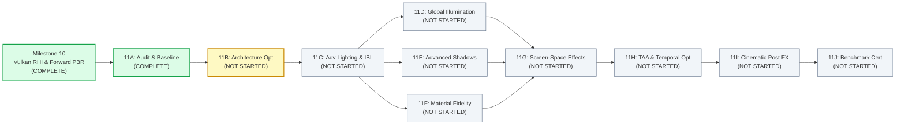
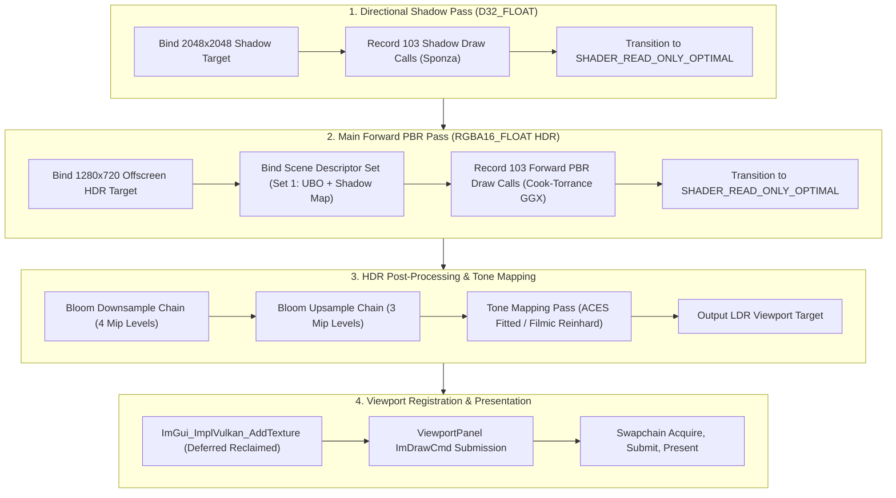
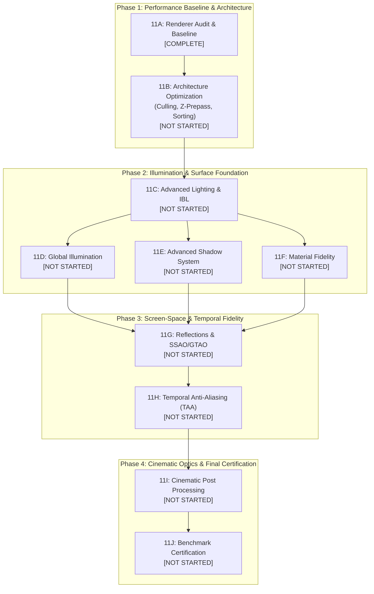

# Hikari Rendering Evolution: Milestone 11 Master Roadmap
## Real-Time Photorealistic Rendering & Performance Engineering

**Document ID:** `ROADMAP-M11-2026-REV1`  
**Author:** Hikari Engine Architecture Team  
**Date:** November 13, 2026  
**Governing Standard:** Repository Contract [`/AGENTS.md`](../../AGENTS.md)  
**Status:** Authoritative Master Roadmap  

---

## 1. Executive Summary & Vision

The **Milestone 11 Series: Hikari Rendering Evolution** represents the engine's transition from foundational GPU rasterization (Milestones 10A–10G) into a production-grade, photorealistic real-time rendering engine.

### Core Mission:
> **Deliver physically based, cinematic visual fidelity and microsecond-level frame-time consistency on hardware-neutral Vulkan RHI, validated continuously against standardized real-world benchmarks.**

Hikari's primary differentiator is its **Two-State Conductor over a single shared World**. Visual fidelity must never compromise runtime determinism, input responsiveness, or the strict $16.6\text{ ms}$ (60 FPS) frame budget on Tier 0 test floor hardware.



---

## 2. Hardware Baseline & System Topology

All architectural decisions and performance budgets in Milestone 11 are measured against a dedicated hardware test floor. In accordance with `AGENTS.md §1`, the test floor is a **minimum performance floor**, never a vendor-specific design target.

### 2.1 Hardware Specification (Tier 0 Test Floor)
* **Primary Rendering GPU (Headless Compute & Render):** NVIDIA P106-100 (Pascal GP106, 6GB GDDR5, 1280 CUDA Cores, PCIe 3.0 x16, Bus `01:00.0`).
* **Display / Compositor GPU (Desktop & Window Output):** NVIDIA GeForce GT 1030 (Pascal GP108, 2GB GDDR5, 384 CUDA Cores, PCIe 3.0 x4, HDMI/DP Display Out, Bus `0B:00.0`).
* **Host CPU:** x86_64 Multi-Core Processor.
* **Operating System:** Linux 6.17 x86_64, Wayland / XWayland compositor.
* **Graphics API:** Vulkan 1.4.312 (NVIDIA Driver 580.159.04).

### 2.2 System Topology Constraints
1. **Cross-GPU Swapchain Presentation:** Offscreen rendering occurs on GPU 0 (P106-100), whose swapchain presentation transfers rendered images across the PCIe bus to GPU 1 (GT 1030) for desktop compositing. Uncapped presentation can flood the PCIe bus; proper synchronization and frame rate limits are mandatory.
2. **Memory Budgets:**
   - GPU 0 VRAM Budget: $4.5\text{ GB}$ ceiling ($1.5\text{ GB}$ driver/OS reserve).
   - Hot Path Allocations: Zero heap allocations (`malloc`, `new`, `std::vector` resizing) during per-frame command recording or rendering passes.
3. **Hardware Feature Tiering:**
   - **Tier 0 (Baseline, Mandatory):** Vulkan 1.3 Dynamic Rendering, non-solid fill mode (`fillModeNonSolid`), timestamp queries, bindless textures via descriptor indexing where available, fallback forward PBR.
   - **Tier 1 (Mainstream):** Conservative rasterization, multi-viewport, subgroup operations.
   - **Tier 2 (Enthusiast):** Hardware ray tracing (`VK_KHR_ray_tracing_pipeline`), mesh shading (`VK_EXT_mesh_shader`). Tier 2 features must always provide an automated Tier 0 fallback.

---

## 3. Resolution of Historical Naming Conflicts

To prevent ambiguity and historical regression, the following separate implementations are explicitly documented and distinguished:

### 3.1 Historical Work Item A: Previous Graphics Settings & Scalability Framework
* **Status:** **COMPLETE**
* **Summary:** Delivered strongly typed configuration structures (`GraphicsSettings`), fidelity presets (`Low`, `Medium`, `High`, `Ultra`, `Cinematic`, `Custom`), hardware capability validation against `rhi::GpuCaps`, transactional JSON persistence at `assets/config/graphics_settings.json`, and dynamic runtime controls (shadow map resolution, PCF quality, exposure, tone mapping operators, bloom parameters, wireframe debug view, and dynamic VSync).
* **Historical Conflict Note:** This work item was previously referred to informally in intermediate task prompts as "Milestone 11B". **It is complete and distinct from the new Milestone 11B.**

### 3.2 Historical Work Item B: Editor Settings & Preferences Architecture Refactoring
* **Status:** **COMPLETE**
* **Summary:** Refactored the separate `ProjectSettingsPanel` window into the unified, professional `SettingsPanel`, integrating global user preferences (`EditorPreferences`: autosave, UI scaling, external script editor integration) with project graphics settings, complete with safe viewport descriptor set reclamation and bidirectional theme state synchronization (`ThemeType`).

### 3.3 Milestone 11A: Renderer Audit & Performance Baseline
* **Status:** **COMPLETE**
* **Summary:** Full technical audit of live scene rendering vs Dear ImGui UI overlay draw calls, Vulkan hardware timestamp query validation, Sponza benchmark integrity certification, and GPU pass breakdown accounting.

### 3.4 New Milestone 11B: Rendering Architecture Optimization
* **Status:** **NOT STARTED**
* **Summary:** The actual technical optimization of the rendering pipeline: Viewport frustum culling, depth pre-pass (Z-prepass), state sorting, multi-draw indirect preparation, and multi-frame in-flight synchronization ($N=2$).
* **Authoritative Rule:** **The previous Graphics Settings framework does not replace, redefine, or satisfy the scope of Milestone 11B.**

---

## 4. Current Renderer Architecture (Milestone 11A Baseline)

The current rendering architecture established in Milestones 10A–10F, certified in 10G, and audited in 11A operates as a forward HDR rendering pipeline:



### 4.1 Measured Baseline Performance (Sponza Benchmark at 1280×720 on P106-100)
From the authoritative Milestone 11A audit ([`sponza_benchmark_integrity_and_gpu_profiling_audit.md`](file:///home/lux/.gemini/antigravity/brain/5a78668b-c9c7-478a-bc65-c220c4766ff6/sponza_benchmark_integrity_and_gpu_profiling_audit.md)):

| Render Stage / Pass | Execution Duration (ms) | Percentage of Scene Time |
| :--- | :---: | :---: |
| **Directional Shadow Pass (2048×2048)** | **15.81 ms** | 45.36% |
| **Main Forward PBR Pass (1280×720 HDR)** | **18.94 ms** | 54.36% |
| **Bloom Downsample (4 levels)** | **0.03 ms** | 0.09% |
| **Bloom Upsample (3 levels)** | **0.01 ms** | 0.03% |
| **Tone Mapping & Presentation** | **0.03 ms** | 0.09% |
| **Pipeline Barrier Transitions** | **0.03 ms** | 0.09% |
| **Total Hardware Scene Duration** | **34.84 ms** (28.7 FPS) | **100.0%** |

**Identified Optimization Bottlenecks:**
1. Zero frustum culling: All 103 submeshes (262,267 triangles) are drawn into the main pass and shadow pass regardless of camera visibility ($524,534\text{ triangles/frame}$).
2. Zero depth pre-pass: Forward pixel shaders execute on occluded interior geometry.
3. Brute-force single 2048×2048 shadow projection covering the entire world without cascading.

---

## 5. Complete Milestone Breakdown (11A–11J)

The complete sequence from 11A to 11J is preserved in its entirety below.

```
+---------------------------------------------------------------------------------------------------+
|                                  MILESTONE 11 ROADMAP MATRIX                                      |
+------+------------------------------------------+-------------------+-----------------------------+
| ID   | Milestone Name                           | Status            | Primary Technical Focus     |
+------+------------------------------------------+-------------------+-----------------------------+
| 11A  | Renderer Audit & Performance Baseline    | COMPLETE          | Hardware Timestamps & Profiling |
| 11B  | Rendering Architecture Optimization      | NOT STARTED       | Frustum Culling, Z-Prepass  |
| 11C  | Advanced Lighting & Image-Based Lighting | NOT STARTED       | Split-Sum IBL, Clustered    |
| 11D  | Global Illumination                      | NOT STARTED       | Irradiance Volumes & SSGI   |
| 11E  | Advanced Shadow System                   | NOT STARTED       | Cascaded Shadows (CSM), PCSS|
| 11F  | Material & Surface Fidelity              | NOT STARTED       | MikkTSpace, Clearcoat, Trans|
| 11G  | Reflection & Screen-Space Effects        | NOT STARTED       | Hi-Z SSR, GTAO Ground Truth |
| 11H  | Advanced Anti-Aliasing & Temporal Tech   | NOT STARTED       | TAA, Motion Vectors, Jitter |
| 11I  | Cinematic Post Processing                | NOT STARTED       | Bokeh DoF, Motion Blur, LUT |
| 11J  | Photorealistic Benchmark Certification   | NOT STARTED       | Multi-Scene Visual Sign-off |
+------+------------------------------------------+-------------------+-----------------------------+
```

---

### Milestone 11A: Renderer Audit & Performance Baseline
* **Status:** **COMPLETE**
* **Prerequisites:** Milestones 10A–10G.
* **Objective:** Establish unassailable, hardware-measured performance baselines, verify Sponza benchmark workload integrity, and validate double-buffered GPU timestamp telemetry.
* **Deliverables:**
  - Double-buffered `VkQueryPool` timestamp measurement pipeline (`VulkanDevice`, `SceneRenderer`).
  - Separation of 3D scene geometry statistics from 2D Dear ImGui overlay draw calls in `RenderStats`.
  - Resolution of previous telemetry discrepancies (22 UI draws vs 206 scene draws; 103 submeshes vs 66 typo).
  - Profiling validation tool `tools/profile_gpu_serialization.cpp`.
* **Repository Evidence:**
  - Commits: `dca2bb2`, `3dc3e26`, `a6d46b6`, `e24d347`, `90a756f`, `55174d7`, `505ce4f`, `1c1424b`, `45a180d`.
  - Architecture Audit Report: [`sponza_benchmark_integrity_and_gpu_profiling_audit.md`](file:///home/lux/.gemini/antigravity/brain/5a78668b-c9c7-478a-bc65-c220c4766ff6/sponza_benchmark_integrity_and_gpu_profiling_audit.md).
  - Telemetry Audit: [`telemetry_fps_audit_report.md`](file:///home/lux/.gemini/antigravity/brain/5a78668b-c9c7-478a-bc65-c220c4766ff6/telemetry_fps_audit_report.md).
* **Acceptance Criteria Met:** Hardware timestamp sum matches total scene time within 99.91% ($34.81\text{ ms} / 34.84\text{ ms}$). Zero overlap, zero query leaks.

---

### Milestone 11B: Rendering Architecture Optimization
* **Status:** **NOT STARTED**
* **Prerequisites:** Milestone 11A.
* **Objective:** Eliminate wasteful GPU vertex and fragment processing through view frustum culling, depth pre-pass, state sorting, and multi-frame in-flight pipelining.
* **Technical Scope & Deliverables:**
  1. **Frustum Culling Engine:**
     - Extract camera frustum planes (6 planes in world space) from view-projection matrix.
     - Evaluate entity world-space Axis-Aligned Bounding Boxes (AABB) using SIMD/fast plane tests.
     - Cull non-visible entities before command recording for both main camera and shadow cascades.
     - Maintain accurate `culledPrimitives` count in `RenderStats`.
  2. **Depth Pre-Pass (Z-Prepass):**
     - Lightweight early-Z pass rendering position-only geometry (`D32_FLOAT`) with color write disabled.
     - Main forward pass transitions depth buffer to `VK_IMAGE_LAYOUT_DEPTH_STENCIL_READ_ONLY_OPTIMAL` with `depthCompareOp = VK_COMPARE_OP_EQUAL`.
     - Completely eradicates expensive Cook-Torrance fragment shader overdraw on occluded surfaces.
  3. **State & Material Sorting:**
     - Sort draw calls front-to-back for opaque meshes, grouping by pipeline and descriptor set to minimize Vulkan driver state changes.
  4. **Multi-Frame In-Flight Synchronization:**
     - Implement clean 2-frame in-flight resource ring-buffering ($N=2$) with individual frame fences and command pools to eliminate CPU wait-idle stalling.
* **Acceptance Criteria:**
  - Sponza main PBR duration reduced from $18.94\text{ ms}$ to $\le 9.0\text{ ms}$ on P106-100.
  - Frustum culling culls $\ge 30\%$ of geometry when camera is inside Sponza colonnade.
  - Zero visible popping, zero z-fighting, sanitizer-clean execution.
* **Explicit Exclusions:** New material models, IBL shaders, ray tracing, temporal jittering.

---

### Milestone 11C: Advanced Lighting & Image-Based Lighting (IBL)
* **Status:** **NOT STARTED**
* **Prerequisites:** Milestone 11B.
* **Objective:** Implement physically accurate Image-Based Lighting (IBL) and a scalable multi-light evaluation system.
* **Technical Scope & Deliverables:**
  1. **Split-Sum Environment Map Convolution:**
     - Offline or pre-warm radiance environment map convolution into cubemap mips using GGX importance sampling.
     - Diffuse irradiance cubemap generation (Lambertian convolution).
     - Precomputed 2D BRDF integration LUT texture (split-sum Fresnel scale and bias).
  2. **PBR Environment Integration:**
     - Update PBR fragment shader (`forward_pbr.slang` / SPIR-V) to sample diffuse irradiance and specular prefiltered cubemap.
     - Blend environment reflection with roughness using split-sum approximation matching Khronos glTF PBR specification.
  3. **Clustered / Dynamic Local Lighting:**
     - Support multiple dynamic point lights and spot lights with smooth quadratic distance attenuation and angular falloff.
     - Bounded light grid evaluation in forward pass.
* **Acceptance Criteria:**
  - Metallic surfaces in Damaged Helmet and Flight Helmet realistically mirror the HDR environment with roughness-dependent blurring.
  - Sponza colonnades exhibit smooth ambient fill rather than flat uniform darkness.
  - Hardware pass duration cost $\le 2.0\text{ ms}$ at 1080p.
* **Explicit Exclusions:** Real-time multi-bounce dynamic global illumination, screen-space reflections.

---

### Milestone 11D: Global Illumination (GI)
* **Status:** **NOT STARTED**
* **Prerequisites:** Milestone 11C.
* **Objective:** Bring indirect diffuse bounce illumination into architectural scenes to eliminate black unlit shadow regions.
* **Technical Scope & Deliverables:**
  1. **Irradiance Volume / Probe Grid:**
     - 3D grid of spherical harmonics (SH L2) or octahedral irradiance probes covering the scene volume.
     - Probe raycasting or precomputation of indirect bounce light from sunlit surfaces.
     - Trilinear interpolation across probe grid in forward PBR evaluation with light leak prevention (depth-based Chebyshev weights).
  2. **Screen-Space Global Illumination (SSGI) Fallback / Augmentation:**
     - Fast screen-space ray tracing pass sampling high-luminance screen regions to inject short-range diffuse color bleeding.
* **Acceptance Criteria:**
  - Sponza archways and upper floor corridors receive warm bounced sunlight from the sunlit courtyard floor.
  - Zero unlit pitch-black surfaces in shadowed areas.
  - Maximum frame cost $\le 3.5\text{ ms}$ on Pascal test floor.
* **Explicit Exclusions:** Pure path tracing, hardware DXR requirement.

---

### Milestone 11E: Advanced Shadow System
* **Status:** **NOT STARTED**
* **Prerequisites:** Milestone 11C.
* **Objective:** Replace brute-force single shadow projection with multi-cascade directional shadows and contact-hardening soft filtering.
* **Technical Scope & Deliverables:**
  1. **Cascaded Shadow Maps (CSM):**
     - 3 to 4 shadow cascades fitted tightly to camera sub-frusta using logarithmic-practical split distribution.
     - Texel stabilization (snapping projection origin to texel grid increments) eliminating camera rotation edge shimmer.
     - Smooth cascade boundary blending across cascade seams.
  2. **Soft Shadow Filtering (PCSS / EVSM):**
     - Percentage-Closer Soft Shadows (PCSS) with blocker search, variable penumbra estimation, and adaptive PCF kernel.
     - Contact shadows: sharp, defined shadows at object contact points, smoothly softening with distance from caster.
  3. **Omnidirectional Point Light Shadows:**
     - Cubemap shadow targets for dynamic point lights.
* **Acceptance Criteria:**
  - Sponza shadow pass execution drops from $15.81\text{ ms}$ to $\le 6.0\text{ ms}$ across all cascades.
  - Razor-sharp contact shadows under balustrades; zero shadow acne, zero peter-panning.
* **Explicit Exclusions:** Ray-traced shadow rays.

---

### Milestone 11F: Material & Surface Fidelity
* **Status:** **NOT STARTED**
* **Prerequisites:** Milestone 11C.
* **Objective:** Elevate material fidelity to photorealistic standards supporting full glTF 2.0 material extensions.
* **Technical Scope & Deliverables:**
  1. **Normal Mapping & MikkTSpace Tangents:**
     - Complete MikkTSpace compliant vertex tangent generation and bitangent reconstruction in shader.
     - Micro-surface normal perturbation for fabric, stone, scratches, and leather.
  2. **glTF PBR Extensions:**
     - Clearcoat (`KHR_materials_clearcoat`): Secondary specular lobe for lacquered and automotive surfaces.
     - Transmission & Refraction (`KHR_materials_transmission`, `KHR_materials_ior`): Thin and volume absorption for glass and liquid.
     - Sheen (`KHR_materials_sheen`): Micro-fiber backscatter for fabric and velvet.
  3. **Parallax Occlusion Mapping (POM):**
     - Height-map ray marching for deep surface relief (cobblestones, roof tiles) with self-shadowing.
* **Acceptance Criteria:**
  - Flight Helmet and Damaged Helmet pass 100% of Khronos glTF Sample Model validation suites.
  - Fabric banners in Sponza display soft anisotropic sheen; glass visor displays genuine refraction.
* **Explicit Exclusions:** Full procedural skin subsurface scattering (reserved for character pipeline).

---

### Milestone 11G: Reflection & Screen-Space Effects
* **Status:** **NOT STARTED**
* **Prerequisites:** Milestones 11D, 11F.
* **Objective:** Implement physically based screen-space reflections and ground-truth ambient occlusion.
* **Technical Scope & Deliverables:**
  1. **Hierarchical-Z Screen-Space Reflections (Hi-Z SSR):**
     - Min-max depth pyramid generation for fast accelerated ray marching.
     - Reflection ray intersection test with roughness-based cone tracing and jitter.
     - Seamless edge fading and fallback to IBL environment reflection when rays exit screen space.
  2. **Ground-Truth Ambient Occlusion (GTAO):**
     - Physically based horizon search ambient occlusion (GTAO / ASSAO) replacing primitive SSAO.
     - Depth-aware bilateral filter to preserve sharp geometric edges while eliminating sampling noise.
* **Acceptance Criteria:**
  - Wet courtyard tiles in Sponza reflect columns and banners with correct perspective and roughness attenuation.
  - Crevices, molding, and architectural seams exhibit deep, soft contact occlusion without dark halos.
  - Frame cost $\le 3.0\text{ ms}$ combined at 1080p.
* **Explicit Exclusions:** DXR hardware ray-traced reflections.

---

### Milestone 11H: Advanced Anti-Aliasing & Temporal Rendering
* **Status:** **NOT STARTED**
* **Prerequisites:** Milestones 11G, 11B.
* **Objective:** Establish temporal stability and resolve high-frequency geometric and specular aliasing.
* **Technical Scope & Deliverables:**
  1. **Velocity Buffer Generation:**
     - Screen-space motion vectors ($RG16\text{F}$) encoding camera movement and dynamic entity displacement.
  2. **Temporal Anti-Aliasing (TAA):**
     - Halton $(2, 3)$ sub-pixel camera projection jitter sequence.
     - History buffer reprojection with bicubic Catmull-Rom sampling.
     - Variance neighborhood color clipping in YCoCg color space to eradicate ghosting behind moving objects.
     - Adaptive sharpening filter (Contrast-Adaptive Sharpening / CAS) restoring high-frequency details.
* **Acceptance Criteria:**
  - Complete elimination of specular crawling and thin-edge staircase aliasing in Sponza iron chains and foliage.
  - Ghosting metric $< 3\%$ on sudden camera panning.
* **Explicit Exclusions:** Proprietary closed-source vendor SDKs (NVIDIA DLSS, AMD FSR); all temporal passes must remain open Vulkan shaders.

---

### Milestone 11I: Cinematic Post Processing
* **Status:** **NOT STARTED**
* **Prerequisites:** Milestone 11H.
* **Objective:** Complete the cinematic optical camera pipeline with physical lens simulation.
* **Technical Scope & Deliverables:**
  1. **Physical Camera Model:**
     - ISO, shutter speed, aperture ($f$-stop), lens focal length, Circle of Confusion (CoC) calculation.
  2. **Cinematic Depth of Field (DoF):**
     - Separable disk/bokeh blur convolution with foreground/background isolation.
  3. **Motion Blur:**
     - Velocity-buffer driven directional pixel smear for fast camera sweeps and rapid action.
  4. **Lens Optics & Color Grading:**
     - Optical vignetting, chromatic aberration, lens distortion.
     - Filmic color grading via 3D tetrahedral LUT sampling ($32\times 32\times 32$ texture).
* **Acceptance Criteria:**
  - Viewport camera can achieve photographic macro focus on Damaged Helmet with smooth bokeh blur.
  - Total post-processing overhead $\le 2.0\text{ ms}$ at 1080p.
* **Explicit Exclusions:** Offline non-real-time ray-traced lenses.

---

### Milestone 11J: Photorealistic Benchmark Certification
* **Status:** **NOT STARTED**
* **Prerequisites:** Milestones 11A–11I.
* **Objective:** Final integration, automated regression testing, and visual sign-off of the complete Hikari Photorealistic Rendering Pipeline across standardized benchmark scenes.
* **Technical Scope & Deliverables:**
  1. **Standardized Certification Suite:**
     - Automated headless and windowed benchmark harness running:
       - `Sponza_Benchmark.hikari`: Full architectural lighting, CSM, IBL, GI, Hi-Z reflections.
       - `FlightHelmet_Benchmark.hikari`: Complex PBR materials, clearcoat, transmission, micro-occlusion.
       - `DamagedHelmet_Benchmark.hikari`: Metallic roughness, normal mapping, HDR bloom, cinematic post.
  2. **Golden Image Regression Testing:**
     - Automated pixel-difference validation against certified golden reference frames ($\text{PSNR} \ge 40\text{ dB}$, $\text{SSIM} \ge 0.98$).
  3. **Performance & Memory Certification Report:**
     - Frame time p99 $\le 16.6\text{ ms}$ (60 FPS) at 1080p on Pascal test floor.
     - VRAM consumption verified flat across 10,000 continuous benchmark cycles.
* **Acceptance Criteria:**
  - Formal sign-off and certification of the Milestone 11 series.
* **Explicit Exclusions:** Production game shipping.

---

## 6. Milestone Dependencies & Execution Sequence

Strict sequencing ensures that optimizations precede heavy shader additions, and lighting precedes screen-space effects.



---

## 7. Performance & Quality Validation Standards

To ensure architectural integrity, every milestone must fulfill the following non-negotiable criteria before declaration of completion:

### 7.1 Performance Budgets (Pascal P106-100 Test Floor at 1080p)
* **Overall Frame Time Target:** $\le 16.6\text{ ms}$ (p99 $\le 16.6\text{ ms}$, 60 FPS).
* **Per-Subsystem GPU Budgets:**
  - Shadow Passes (all cascades combined): $\le 4.5\text{ ms}$.
  - Main PBR & Direct Lighting Pass: $\le 6.0\text{ ms}$.
  - Indirect Illumination / GI: $\le 2.5\text{ ms}$.
  - Screen-Space Reflections & Ambient Occlusion: $\le 2.0\text{ ms}$.
  - Temporal Anti-Aliasing: $\le 1.0\text{ ms}$.
  - Cinematic Post-Processing: $\le 1.5\text{ ms}$.
  - Pipeline Barriers & GPU Overhead: $\le 0.5\text{ ms}$.
  - **Total GPU Budget:** $\le 18.0\text{ ms}$ (at 1080p High); $\le 14.5\text{ ms}$ (at 1080p Medium).

### 7.2 Memory Budgets
* **GPU Dedicated VRAM:** Total engine consumption $\le 2.5\text{ GB}$ on standard benchmark scenes.
* **Leak Neutrality:** A stress test switching scenes or cycling modes 5,000 times must display completely flat memory profiles (verified via ASan and Tracy memory plots).
* **Zero Hot Path Heap Allocations:** All per-frame buffers, descriptors, and command structures must use pre-allocated ring buffers or linear frame allocators.

### 7.3 Visual Quality Standards
* **Physical Energy Conservation:** Total outgoing radiance must never exceed incoming irradiance.
* **glTF 2.0 PBR Compliance:** Exact adherence to the Khronos glTF PBR specification and officially published reference renderings.
* **Temporal Stability:** Zero crawling, shimmering, or Moire interference patterns on static or slowly panning views.

---

## 8. Supporting Documentation & Evidence Index

This master roadmap synthesizes and links to the following foundational technical reports and architecture documents in the repository:

### 8.1 Repository Architecture & Decision Records
- Engine Rules & Agent Contract: [`AGENTS.md`](../../AGENTS.md)
- Layered Architecture Specification: [`docs/architecture/layers.md`](../architecture/layers.md)
- Two-State Conductor Architecture: [`docs/architecture/conductor.md`](../architecture/conductor.md)
- Vulkan RHI Backend Architecture: [`docs/adr/0010-vulkan-rhi-backend.md`](../adr/0010-vulkan-rhi-backend.md)
- Render Graph Architecture: [`docs/adr/0011-render-graph-architecture.md`](../adr/0011-render-graph-architecture.md)

### 8.2 Historical Implementation & Settings Architecture
- Graphics Settings & Scalability Framework: [`docs/architecture/graphics_settings_and_scalability.md`](../architecture/graphics_settings_and_scalability.md)
- Editor Settings & Preferences Architecture: [`docs/architecture/editor_preferences_and_settings.md`](../architecture/editor_preferences_and_settings.md)
- Critical Settings Regressions Investigation & Repair Report: [`critical_settings_regressions_investigation_and_repair.md`](file:///home/lux/.gemini/antigravity/brain/5a78668b-c9c7-478a-bc65-c220c4766ff6/critical_settings_regressions_investigation_and_repair.md)

### 8.3 Benchmark Certification & Audit Reports
- Milestone 10G Sponza Benchmark Certification: [`docs/architecture/milestone_10g_sponza_benchmark_certification.md`](../architecture/milestone_10g_sponza_benchmark_certification.md)
- Persistent Benchmark Scenes User Guide: [`docs/benchmark_scenes.md`](../benchmark_scenes.md)
- Milestone 11A Sponza Benchmark Integrity & GPU Profiling Audit: [`sponza_benchmark_integrity_and_gpu_profiling_audit.md`](file:///home/lux/.gemini/antigravity/brain/5a78668b-c9c7-478a-bc65-c220c4766ff6/sponza_benchmark_integrity_and_gpu_profiling_audit.md)
- GPU Utilization, Frame Latency, & Synchronization Audit: [`gpu_utilization_latency_synchronization_report.md`](file:///home/lux/.gemini/antigravity/brain/5a78668b-c9c7-478a-bc65-c220c4766ff6/gpu_utilization_latency_synchronization_report.md)
- Real-Time Telemetry & FPS Audit: [`telemetry_fps_audit_report.md`](file:///home/lux/.gemini/antigravity/brain/5a78668b-c9c7-478a-bc65-c220c4766ff6/telemetry_fps_audit_report.md)

### 8.4 Missing Documentation Notice
* The following milestone-specific detailed design specifications have **not yet been authored** and will be written upon commencement of their respective milestones:
  - `docs/architecture/milestone_11b_rendering_architecture_optimization.md` (Missing / Pending Start)
  - `docs/architecture/milestone_11c_advanced_lighting_and_ibl.md` (Missing / Pending Start)
  - `docs/architecture/milestone_11d_global_illumination.md` (Missing / Pending Start)
  - `docs/architecture/milestone_11e_advanced_shadow_system.md` (Missing / Pending Start)
  - `docs/architecture/milestone_11f_material_and_surface_fidelity.md` (Missing / Pending Start)
  - `docs/architecture/milestone_11g_reflection_and_screen_space_effects.md` (Missing / Pending Start)
  - `docs/architecture/milestone_11h_temporal_anti_aliasing.md` (Missing / Pending Start)
  - `docs/architecture/milestone_11i_cinematic_post_processing.md` (Missing / Pending Start)
  - `docs/architecture/milestone_11j_photorealistic_benchmark_certification.md` (Missing / Pending Start)
